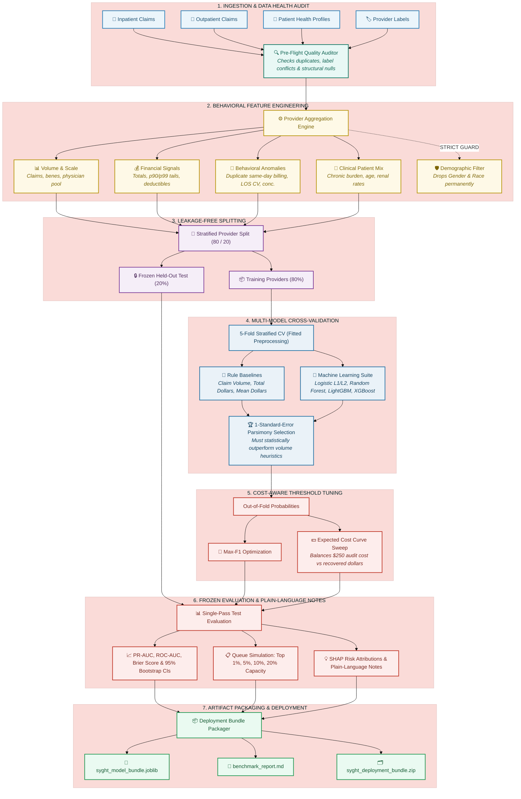

<div align="center">

# 🩺 Syght — Healthcare Fraud-Risk Detection Platform

**A practical, high-precision machine learning system built for health insurance teams to spot suspicious billing anomalies, prioritize provider investigations, and protect healthcare funds.**

[](https://www.python.org/)
[](docs/reference_repositories.md)
[](tests/)
[](#why-accuracy-is-deceptive-in-fraud-detection)
[](#transparent-auditor-explanations)
[](#training-in-google-colab)

<p align="center">
  <a href="#why-syght">Why Syght</a> •
  <a href="#pipeline-architecture">Architecture</a> •
  <a href="#benchmark-dataset--scope-guidelines">Dataset & Scope</a> •
  <a href="#the-58-feature-suite">Feature Suite</a> •
  <a href="#model-selection--evaluation">Evaluation</a> •
  <a href="#training-in-google-colab">Colab Training</a> •
  <a href="#running-predictions">Inference</a> •
  <a href="#local-testing">Testing</a>
</p>

</div>

---

> [!NOTE]
> **A Tool for Human Investigators, Not an Automated Judge**  
> In healthcare insurance, an algorithm should never act as judge and jury. Syght is built strictly for **decision support**. It flags statistical anomalies, estimates risk probabilities, and ranks investigation queues so human auditors and Special Investigation Units (SIUs) can direct their time and expertise where financial exposure and suspicious patterns are highest.

---

## 💡 Why Syght?

Healthcare billing fraud costs billions of dollars each year, but catching it is difficult:
- **Needle in a haystack**: Legitimate claims vastly outnumber fraudulent ones (~9% base rate in benchmark studies). A naive model that simply marks everything "clean" achieves 91% accuracy while catching nothing.
- **Auditor fatigue**: Human investigation takes hours per case. Flooding review teams with false positives wastes clinical resources and destroys confidence in automated tooling.
- **Complex billing schemes**: Real-world fraud rarely happens in a single isolated claim. It reveals itself across longitudinal patterns: duplicate same-day procedures, artificial hospital stay lengths, and physician monopoly billing.
- **Fairness & ethics**: Patient care should never be penalized by demographic bias.

Syght solves these operational hurdles by collapsing multi-table insurance claims into **58 defensible provider behavioral signals**, testing multiple machine learning candidates against **simple billing heuristics**, and picking operating thresholds based on **real-world investigation costs**.

---

## 📐 Pipeline Architecture

Syght processes complex healthcare billing through seven cohesive, leak-free stages:



---

## 📊 Benchmark Dataset & Scope Guidelines

Syght evaluates performance against an established public healthcare claims benchmark ([Kaggle Claims Dataset](https://www.kaggle.com/datasets/rohitrox/healthcare-provider-fraud-detection-analysis)) containing multi-table institutional billing records.

### Core Design Rules & Scope Boundaries

| Dimension | Syght Standard | Why This Matters |
|---|---|---|
| **Unit of Analysis** | **Provider Level (`Provider`)** | Ground truth fraud labels attach to billing facilities and physician groups, not isolated claim lines. Evaluating claims in isolation causes data leakage; evaluating providers reflects how actual billing fraud operates. |
| **Protected Demographics** | **Excluded by Design** | Patient demographics (`Gender`, `Race`) are stripped from the feature space before modeling. Providers are evaluated purely on billing patterns, volume ratios, and clinical concentrations. |
| **Privacy & Storage** | **Cloud-Only Raw Data** | Raw claims data lives exclusively in temporary Google Colab cloud storage during training. Raw records and credentials are never stored locally or pushed to Git. |
| **Claim-Level Caution** | **Provider-Trained Context** | A high provider risk score reflects suspicious organizational billing patterns. It does not prove that every single claim from that provider is fraudulent. Separate claim-level audits require dedicated claim-level validation. |

---

## 🧬 The 58-Feature Suite

Raw hospital claims and patient records are condensed into **58 high-signal features** organized into four operational categories:

### 1. Volume & Scale (13 Features)
Measures the operational footprint and billing velocity of the provider:
- `n_claims`: Total claims billed during the observation period.
- `n_inpatient_claims`, `n_outpatient_claims`, `inpatient_share`: Distribution between hospitalization and ambulatory care.
- `n_unique_beneficiaries`: Patient pool size.
- `n_unique_attending_physicians`, `n_unique_operating_physicians`, `n_unique_other_physicians`: Medical staffing diversity.
- `claims_per_beneficiary`, `claims_per_attending_physician`, `claims_per_operating_physician`: Utilization density per clinician and patient.
- `inpatient_claims_per_beneficiary`, `outpatient_claims_per_beneficiary`: Setting-specific patient utilization rates.

### 2. Billing & Financial Profiles (15 Features)
Captures money flow, high-dollar outliers, and patient cost-sharing:
- `total_reimbursed`, `mean_reimbursed`, `median_reimbursed`, `std_reimbursed`, `max_reimbursed`: Reimbursement distribution summary.
- `p90_reimbursed`, `p99_reimbursed`: 90th and 99th upper-tail percentiles to detect extreme billing outliers.
- `total_deductible`, `mean_deductible`, `max_deductible`: Patient deductible distributions.
- `deductible_to_reimbursement_ratio`: Ratio of out-of-pocket patient payment to insurance reimbursement.
- `reimbursed_per_beneficiary`, `reimbursed_per_attending_physician`: Revenue generated per patient and per physician.
- `mean_reimbursed_inpatient`, `mean_reimbursed_outpatient`: Average payout broken down by inpatient vs. outpatient claims.

### 3. Behavioral Patterns & Billing Anomalies (19 Features)
Pinpoints operational irregularities and unbundling tactics:
- `pct_duplicate_bene_claims_same_day`: Percentage of claims where the same patient was billed multiple times on the exact same date (a primary indicator of fragmented or duplicate billing).
- `top_physician_concentration`: Herfindahl-style index measuring whether billing is dominated by a single doctor.
- `top_diagnosis_concentration`: Diagnosis diversity index (flags clinical "cookie-cutter" billing).
- `mean_claim_duration_days`, `pct_claims_zero_duration`: Billing duration characteristics.
- `mean_admit_days`, `std_admit_days`, `max_admit_days`: Inpatient length of stay (LOS) statistics.
- `ip_cv_los`: Coefficient of Variation of inpatient length of stay ($\text{std} / \text{mean}$) capturing unnatural stay uniformity.
- `pct_claims_missing_attending`, `pct_claims_with_operating_physician`, `pct_claims_with_other_physician`: Provider staffing documentation completeness.
- `mean_n_diagnosis_codes`, `mean_n_procedure_codes`, `pct_claims_with_procedure`: Clinical code complexity per claim.
- `unique_diagnosis_count`, `unique_procedure_count`: Total distinct diagnostic and procedure codes billed.
- `n_states_served`, `n_counties_served`: Geographic reach of the provider's patient base.

### 4. Clinical Patient Mix (11 Features)
Accounts for genuine patient sickness to prevent penalizing clinics treating high-acuity patients:
- `mean_patient_age`, `std_patient_age`: Patient age distribution.
- `pct_patients_deceased`: Mortality rate among treated beneficiaries.
- `mean_chronic_conditions`: Average comorbid condition burden across 11 major chronic illness categories.
- `mean_chronic_diabetes_rate`, `mean_chronic_heartfailure_rate`: Specific prevalence of high-cost chronic diseases.
- `pct_renal_disease`: Prevalence of End-Stage Renal Disease (ESRD) among treated patients.
- `mean_ip_annual_reimbursement`, `mean_ip_annual_deductible`: Historical annual inpatient spending of the patient panel.
- `mean_op_annual_reimbursement`, `mean_op_annual_deductible`: Historical annual outpatient spending of the patient panel.

---

## ⚖️ Model Selection & Evaluation

### Why Accuracy is Deceptive in Fraud Detection
In healthcare billing, legitimate providers account for roughly 90% of all entities. A naive baseline that marks every single provider as legitimate scores **90.65% accuracy** while catching exactly **zero fraud**.

For this reason, Syght treats **Precision-Recall AUC (PR-AUC / Average Precision)** as the primary benchmark metric:

```
               ┌────────────────────────────────────────────────────────┐
               │              Primary Evaluation Metrics                │
               ├─────────────────────────┬──────────────────────────────┤
               │ PR-AUC (Average Prec.)  │ Primary Benchmark Criterion  │
               │ ROC-AUC                 │ Secondary Discrimination     │
               │ 95% Bootstrap CIs       │ Statistical Significance     │
               │ Brier Score             │ Probability Calibration      │
               │ Precision@K & Recall@K  │ Real-World Investigation Load│
               └─────────────────────────┴──────────────────────────────┘
```

### The 1-Standard-Error Parsimony Rule
More complex models are not always better. Syght evaluates 3 heuristic rule baselines alongside 5 ML candidates. An ML model is only adopted if its cross-validated PR-AUC is **statistically higher than simple billing volume rules by at least 1 Standard Error**. If two models perform within 1 SE of each other, the simpler, more regularized model is selected to guard against overfitting.

### Real-World Cost Optimization Curve
Default $0.50$ thresholds assume false alarms and missed fraud carry equal cost. In reality, reviewing a flagged provider costs investigator time, while missing an active fraud ring costs significant financial exposure.

Syght computes the optimal operating threshold by minimizing total operational cost:
$$\text{Cost}(\theta) = (\text{TP}(\theta) + \text{FP}(\theta)) \times C_{\text{investigate}} + \sum_{i \in \text{FN}(\theta)} (\text{Exposure}_i \times R_{\text{recovery}})$$

- **Investigation Cost ($C_{\text{investigate}}$)**: ~$250 fixed cost per human case audit.
- **Recovery Fraction ($R_{\text{recovery}}$)**: Realistic estimated recovery rate (typically 30%) on missed fraudulent exposure.

### Investigation Queue Simulation (Top-K Capacity)
Audit teams rarely have unlimited capacity. Syght models what happens when a team can only review a fixed percentage of providers:

| Capacity Tier | Typical Workload | Recommended Strategy | Expected Outcome |
|---|---|---|---|
| **Top 1%** | ~11 providers | High-probability ranking | Quick wins, high precision, minimal auditor fatigue |
| **Top 5%** | ~54 providers | Balanced probability & exposure | Core SIU workload, optimal cost-recovery balance |
| **Top 10%** | ~108 providers | Stratified size-banded review | Broad network review covering large facilities and small clinics |
| **Top 20%** | ~216 providers | Maximum recovery audit | Broad regulatory sweep, near-complete exposure capture |

---

## 💡 Transparent Auditor Explanations

Black-box scores frustrate investigators. When Syght flags a provider, it translates underlying SHAP values into readable, human-friendly notes:

```
Provider PRV51001 — Risk Score: 84.2% [CRITICAL PRIORITY]
Recommendation: High priority for Special Investigation Unit audit.

Key Billing Factors Contributing to Risk:
  ▲ [HIGH RISK]   18.4% of claims had duplicate same-day billing for identical patients (Unbundling pattern)
  ▲ [HIGH RISK]   85.2% of all billing was concentrated under a single attending physician
  ▲ [HIGH RISK]   Inpatient Length of Stay CV was 1.45 (Abnormally uniform hospital duration)
  ▼ [MITIGATING]  Patient panel had an average of 4.8 chronic conditions (High clinical complexity)
```

---

## 🚀 Training in Google Colab

The entire training, cross-validation, tuning, evaluation, and artifact bundling process runs in a single Google Colab notebook:
👉 **[`notebooks/syght_model_training.ipynb`](https://colab.research.google.com/github/toffee4u/Syght/blob/main/notebooks/syght_model_training.ipynb)**

### Step-by-Step Training Guide

#### 1. Open the Notebook
Click the link above to open `syght_model_training.ipynb` directly in Google Colab, then click **Connect** in the top right.

#### 2. Provide Kaggle Credentials
To let Colab download the benchmark dataset:
- Head to [Kaggle](https://www.kaggle.com/) → **Settings** → **Create New Token** (downloads `kaggle.json`).
- In Google Colab's left sidebar, click the **Secrets (🔑)** tab:
  - Add `KAGGLE_USERNAME` = your Kaggle username.
  - Add `KAGGLE_KEY` = your Kaggle API key.
  - Turn **Notebook access** ON for both.
  *(Alternatively, you can upload `kaggle.json` directly when prompted in Cell 3).*

#### 3. Run All Cells
Select **Runtime ➔ Run all** (`Ctrl + F9`). The notebook will:
1. Install dependencies (`xgboost==2.1.3`, `shap==0.49.1`, etc.).
2. Clone your repository (`https://github.com/toffee4u/Syght.git`).
3. Download and extract the claims benchmark into Colab's temporary memory (`/content/data/raw`).
4. Run pre-flight quality checks and build all 58 features.
5. Perform 5-fold cross-validation across all baseline rules and ML models.
6. Select the winning model via the 1-SE rule and optimize the decision threshold.
7. Run the frozen held-out test evaluation, generating PR, ROC, confusion matrix, and cost plots.
8. Generate SHAP explanations and simulate Top-K investigation queues.
9. Package everything into `syght_deployment_bundle.zip` and trigger an automatic browser download!

---

## 💻 Running Predictions

Once you have your trained `syght_model_bundle.joblib`, you can score providers directly with clean, readable code:

```python
from ml_pipeline.predict import SyghtPredictor

# 1. Load the trained deployment bundle
predictor = SyghtPredictor.load("models/syght_model_bundle.joblib")

# 2. Score a provider's engineered billing profile
provider_data = {
    "Provider": "PRV51001",
    "n_claims": 240,
    "total_reimbursed": 385000.0,
    "pct_duplicate_bene_claims_same_day": 0.18,
    "top_physician_concentration": 0.85,
    "top_diagnosis_concentration": 0.72,
    "mean_chronic_conditions": 4.8,
    "ip_cv_los": 1.45,
    # ... additional engineered features
}

prediction = predictor.predict_provider(provider_data)

# 3. Decision-support output
print(f"Provider:              {prediction['provider_id']}")
print(f"Risk Score:            {prediction['fraud_risk_score']:.1%}")
print(f"Risk Percentile:       Top {100 - prediction['risk_percentile']:.1f}%")
print(f"Priority Band:         {prediction['priority_level']}")
print(f"Audit Recommended:     {'YES - FLAG FOR REVIEW' if prediction['investigation_recommended'] else 'NO - STANDARD MONITORING'}")
print("\nTop Contributing Factors:")
for driver in prediction["key_risk_drivers"]:
    print(f"  • {driver['factor']} ({driver['importance_weight']:+.3f})")
```

### Structured Output Format
```json
{
  "provider_id": "PRV51001",
  "fraud_risk_score": 0.842,
  "predicted_class": 1,
  "priority_level": "CRITICAL",
  "risk_percentile": 96.8,
  "investigation_recommended": true,
  "threshold_applied": "cost_optimal",
  "threshold_used": 0.320,
  "key_risk_drivers": [
    {
      "factor": "Frequent duplicate same-day billing for identical patients",
      "feature": "pct_duplicate_bene_claims_same_day",
      "value": 0.18,
      "importance_weight": 0.412
    },
    {
      "factor": "High billing concentration among very few physicians",
      "feature": "top_physician_concentration",
      "value": 0.85,
      "importance_weight": 0.285
    }
  ]
}
```

---

## 🛠️ Local Testing

You don't need access to Kaggle or real data to verify code locally. Syght includes a built-in simulated data generator ([`ml_pipeline/medicare_simulator.py`](file:///c:/toffee/Syght/ml_pipeline/medicare_simulator.py)) that produces exact-schema data in memory:

```bash
# Clone the repository
git clone https://github.com/toffee4u/Syght.git
cd Syght

# Create virtual environment
python -m venv .venv
source .venv/bin/activate  # On Windows: .venv\Scripts\activate

# Install dependencies
pip install -r requirements.txt
pip install -e .

# Run the full automated test suite (21 unit & integration tests)
pytest -v tests
```

---

## 📁 Repository Layout

```
Syght/
├── ml_pipeline/                      # Core Machine Learning Engine
│   ├── config.py                     # Central configuration, seeds, paths & 58 feature definitions
│   ├── data_ingestion.py             # Safe CSV loading, schema validation & robust label derivation
│   ├── data_audit.py                 # Pre-flight data quality, label integrity & duplicate checks
│   ├── medicare_simulator.py         # Realistic claims data simulator for 100% offline testing
│   ├── feature_engineering.py        # 58 provider aggregations with ethical demographic filters
│   ├── split.py                      # Leakage-free provider partitioning & stratified CV splits
│   ├── preprocessing.py              # Median imputation and standard scaling fitted strictly on train folds
│   ├── train.py                      # Heuristic baselines, ML suite, 1-SE selection & feature ablation
│   ├── tune.py                       # Randomized hyperparameter optimization for Average Precision
│   ├── threshold.py                  # Max-F1 and cost-aware operational threshold curves
│   ├── evaluate.py                   # Frozen test evaluation, 95% bootstrap CIs & Top-K queue simulations
│   ├── explain.py                    # SHAP TreeExplainer & plain-language investigator translations
│   ├── predict.py                    # Production inference interface (SyghtPredictor)
│   ├── report.py                     # Markdown and JSON benchmark report generation
│   └── artifacts.py                  # Model bundle serialization (.joblib) & deployment zip packager
├── notebooks/
│   └── syght_model_training.ipynb    # End-to-end 38-cell Google Colab training workflow
├── tests/                            # Automated Test Suite (21 Passing Tests)
├── docs/                             # In-depth architectural & benchmark documentation
├── requirements.txt                  # Pinned dependencies (xgboost==2.1.3, shap==0.49.1, etc.)
├── pyproject.toml                    # Package configuration
└── README.md                         # Project documentation
```

---

## 📜 Research Attribution

Syght incorporates established methodological insights from open-source research implementations (`youlia-denisov/health-fraud-detection-ml-pipeline` and `drakon-codes/provider-fraud-detection`), including schema normalization, pre-flight data audits, rule baselines, cost curves, and investigation queues. All code in `ml_pipeline/` is an **independent, original implementation** written specifically for Syght. Comprehensive research citations and methodological comparisons are documented in [`docs/reference_repositories.md`](file:///c:/toffee/Syght/docs/reference_repositories.md).

---

<div align="center">
  <sub>Built with care for healthcare fraud analysts and Special Investigation Units.</sub>
</div>
