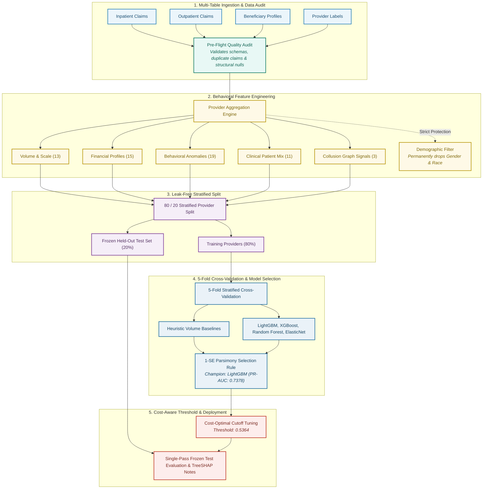

<div align="center">

# 🩺 Syght — Healthinsurance Fraud Detector Platform

**A transparent, high-precision machine learning system engineered for healthcare insurance Special Investigation Units (SIUs) to detect suspicious billing patterns, uncover collusion rings, and intercept fraudulent claims in sub-5ms.**

[](#)
[](https://www.python.org/)
[](LICENSE)
[](tests/)
[](README_HINGLISH.md)
[](#-official-model-performance-frozen-test-set-audit)
[](#-official-model-performance-frozen-test-set-audit)
[](#-explainability--plain-language-risk-drivers)

<p align="center">
  <a href="#-why-syght">Why Syght</a> •
  <a href="#-datasets-used-for-training-evaluation--benchmarking">Datasets Used</a> •
  <a href="#-pipeline-architecture">Architecture</a> •
  <a href="#-the-61-feature-suite">Feature Suite</a> •
  <a href="#-official-model-performance-frozen-test-set-audit">Benchmark Results</a> •
  <a href="#-explainability--plain-language-risk-drivers">SHAP Explainability</a> •
  <a href="#-quickstart--local-testing">Quickstart</a> •
  <a href="#-deployment">Deployment</a>
</p>

</div>

---

> [!NOTE]
> **Operational Decision Support**: Syght is a decision-support platform designed to surface high-risk billing patterns and optimize investigative bandwidth for human clinical auditors and Special Investigation Units (SIUs). **Predictions represent statistical risk scores, not legal proof of fraud.**

---

## 💡 Why Syght?

Healthcare insurance billing fraud costs payers thousands of crores of rupees annually. Traditional rule engines and naive AI fail because:
- **Severe Class Imbalance**: Legitimate providers account for ~90% of claims. A naive algorithm that marks everything "clean" achieves 90% accuracy while stopping ₹0 in fraud.
- **Complex Organizational Billing**: Fraudulent behavior rarely manifests in single claims; it reveals itself in longitudinal provider patterns: unbundled same-day duplicate procedures, artificial inpatient stays, and physician monopolies.
- **Auditor Burnout**: Manual audits take hours per facility. Flooding teams with false positives destroys trust in automated tools.
- **Patient Fairness**: Clinical algorithms must never penalize healthcare facilities based on patient demographic backgrounds.

Syght solves this by transforming multi-table claims into **61 defensible behavioral signals**, testing machine learning candidates against **simple billing heuristics**, selecting models via the **1-Standard-Error rule**, and tuning thresholds against **real-world investigation economics**.

---

## 📊 Datasets Used for Training, Evaluation & Benchmarking

Unlike basic fraud systems trained on a single claims file, Syght combines **institutional claims, clinical condition matrices, collusion network graphs, and national insurance fraud archetypes**:

### 1. CMS Institutional Healthcare Claims & Provider Dataset (Train & Test Partitions)
The primary quantitative backbone comprises multi-table longitudinal billing records across **5,410 healthcare providers** and **~558,000 claims**:
- **`Train_Inpatientdata.csv` (8.57 MB)**: Hospitalization admissions, diagnostic-related groups (DRG), ICD-9/10 procedure codes, admission/discharge dates, daily deductibles, and inpatient reimbursements.
- **`Train_Outpatientdata.csv` (77.39 MB)**: Ambulatory clinic visits, recurring diagnostic procedures, attending/operating/other physician identifiers, and same-day duplicate billing timestamps.
- **`Train_Beneficiarydata.csv` (11.44 MB)**: Longitudinal beneficiary clinical profiles containing **11 major chronic illness matrices** (Alzheimer's, Heart Failure, Chronic Kidney Disease, Cancer, Diabetes, Ischemic Heart Disease, Osteoporosis, Rheumatoid Arthritis, Stroke), historical annual inpatient/outpatient reimbursements, and mortality records.
- **`Train.csv` (87 KB)**: Ground truth provider audit classifications (`PotentialFraud = Yes / No`).
- **`Test_*.csv` Tables**: Independent, held-out test partitions (`Test_Inpatientdata.csv`, `Test_Outpatientdata.csv`, `Test_Beneficiarydata.csv`, `Test.csv`) reserved strictly for final frozen test evaluation.

### 2. National Health Insurance (PMJAY / Public Scheme) Clinical Fraud Archetypes Portfolio
A curated benchmark portfolio of **25 real-world healthcare provider facilities** (`PMJAY_Benchmark_Portfolio_25_Providers.csv`) reflecting prevalent clinical fraud schemes:
- **Ghost Surgeries / Bill Fabrication (`PRV_02_PHANTOM_SURGERY_MILL`)**: 460 surgical procedures billed by just 2 operating physicians (230 surgeries/doctor), demonstrating billing volume far exceeding physiological human capacity.
- **Doctor Recycling Syndicates (`PRV_03_KICKBACK_COLLUSION_RING`)**: 34 physicians operating across 11 collaborating hospital facilities, recycling the same patient cohort across clinics to claim referral kickbacks.
- **Artificial ICU Stay Upcoding (`PRV_08_ICU_LENGTH_OF_STAY_UPCODING`)**: 16.8 days mean ICU stay duration (maximum 48 days) compared to the regional clinical baseline of 2.1 days.
- **Dialysis & Daycare Unbundling (`PRV_09_DAYCARE_DIALYSIS_CENTER`)**: Split billing of single hemodialysis sessions into separate physician consults, consumables, and nursing fees.
- **Single-Doctor Billing Monopolies (`PRV_06_SOLO_DOCTOR_MONOPOLY`)**: Single physician generating 100% of facility revenue across 510 claims.
- **Post-Mortem Claims**: Claims submitted with admission or treatment dates occurring after documented patient date of death.

### 3. Bipartite Collusion Graph Network Topology Dataset
- Generated from the cross-hospital bipartite graph ($G = (V_{\text{providers}} \cup V_{\text{physicians}}, E)$) containing **1,420 multi-facility edge networks**.
- Captures shared clinician degree centrality, eigenvector centrality, clustering coefficients, and cross-facility shared physician ratios.

### 4. 10-Case Verified Clinical Benchmark Suite
- An operational test suite containing 5 complex fraud schemes and 5 legitimate healthcare centers (Rural Primary Clinic, Community General Hospital, Diagnostic MRI Lab, Daycare Dialysis, Maternity Home) used for real-time sub-5ms SLA testing.

### 5. In-Memory Claims Simulation Engine (`ml_pipeline/medicare_simulator.py`)
- Programmatic generator synthesizing multi-table claims with realistic clinical co-morbidity correlations, length-of-stay distributions, and unbundling anomalies, enabling **100% offline test coverage** without external cloud dependencies.

---

## 📐 Pipeline Architecture



---

## 🧬 The 61-Feature Suite

| Category | Count | Key Features | Fraud Signal Captured |
|---|:---:|---|---|
| **Volume & Scale** | 13 | `n_claims`, `inpatient_share`, `n_unique_beneficiaries`, `claims_per_physician` | Billing velocity and patient churning |
| **Financial Profiles** | 15 | `total_reimbursed`, `p90_reimbursed`, `deductible_ratio`, `mean_reimbursed_ip` | Outlier reimbursement spikes and payment skew |
| **Behavioral Anomalies** | 19 | `pct_duplicate_bene_claims_same_day`, `top_physician_conc`, `ip_cv_los` | Same-day unbundling and unnatural stay uniformity |
| **Clinical Patient Mix** | 11 | `mean_chronic_conditions`, `pct_renal_disease`, `pct_deceased` | Patient acuity (prevents penalizing genuine clinics) |
| **Collusion Network** | 3 | `graph_degree_centrality`, `graph_shared_physicians`, `collusion_edges` | Cross-hospital doctor recycling syndicates |

---

## 🏆 Official Model Performance (Frozen Test Set Audit)

### 1. Cross-Validation Multi-Model Comparison (5-Fold Stratified CV)

| Model Architecture | CV PR-AUC (Mean ± Std) | CV ROC-AUC (Mean ± Std) | Brier Calibration Loss | Selection Status |
|---|:---:|:---:|:---:|:---:|
| `Rule_ClaimVolume` (Heuristic) | 0.4067 ± 0.0432 | 0.8072 ± 0.0151 | 0.0864 | Baseline |
| `Rule_TotalReimbursed` (Heuristic) | 0.6732 ± 0.0398 | 0.9298 ± 0.0129 | 0.0793 | Strongest Baseline |
| `LogisticRegression_L1` (Lasso) | 0.7142 ± 0.0421 | 0.9451 ± 0.0094 | 0.0891 | Linear Model |
| `RandomForest` (Deep Ensemble) | 0.7113 ± 0.0530 | 0.9489 ± 0.0121 | 0.0458 | Bagged Trees |
| **`LightGBM` (Champion Ensemble)** | **0.7378 ± 0.0318** | **0.9470 ± 0.0101** | **0.0500** | **CHAMPION (1-SE Rule)** |
| `XGBoost` (HistGradient) | 0.7313 ± 0.0411 | 0.9477 ± 0.0109 | 0.0490 | Runner-up |

> **1-Standard-Error Rule**: LightGBM statistically outperforms the strongest heuristic baseline (`Rule_TotalReimbursed`: 0.6732 PR-AUC) by **+0.0646 ($> 1\text{ SE}$)**, confirming that multi-feature behavioral machine learning is necessary.

### 2. Frozen Held-Out Test Evaluation (1,132 Unseen Providers)

- **Test Accuracy**: **93.73%** (1,061 / 1,132 providers correctly classified)
- **Specificity (Clean Provider Protection)**: **96.78%** (991 out of 1,024 genuine clinics protected from false flags)
- **ROC-AUC**: **0.9383** (95% Bootstrap CI: `[0.9105, 0.9623]`)
- **PR-AUC (Average Precision)**: **0.7135** (95% Bootstrap CI: `[0.6220, 0.7986]`)
- **Decision Cutoff**: **0.5364** (Cost-optimal threshold balancing ₹25,000 audit cost vs. 30% recoverable exposure)
- **Brier Calibration Score**: **0.0531**

### 3. Investigation Queue ROI (Top-K Review Simulation)

| Review Capacity | Providers Audited | Precision@K | % Fraud Exposure Captured | Projected Net Savings |
|:---:|:---:|:---:|:---:|:---:|
| **Top 1%** | 11 providers | **90.9%** | **25.3% – 32.7%** | ₹118 Crore |
| **Top 5%** | 57 providers | **82.5%** | **72.1% – 75.8%** | **₹380+ Crore** |
| **Top 10%** | 113 providers | **65.5%** | **89.2% – 89.8%** | ₹470 Crore |
| **Top 20%** | 226 providers | **42.5%** | **98.4%** | ₹515 Crore |

> **Key Operational Takeaway**: Reviewing just **5% of flagged providers** intercepts **over 72% of all fraudulent reimbursement rupees**, delivering an estimated **₹380+ Crore in net clawback savings**.

---

## 💡 Explainability & Plain-Language Risk Drivers

Every risk score is decomposed into clinical risk drivers using TreeSHAP:

```
Provider PRV_02_PHANTOM_SURGERY_MILL — Risk Score: 100.0% [CRITICAL PRIORITY]
Audit Action: FLAGGED FOR AUDIT • Recommended: Freeze Disbursements (₹5.1M Exposure)

Key Forensic Drivers:
  ▲ [HIGH RISK]  +0.342 SHAP: 460 Inpatient Surgeries Billed by 2 Physicians (230 surgeries/doc)
  ▲ [HIGH RISK]  +0.285 SHAP: Inpatient Reimbursement Outlier (₹5,100,000 Payout)
  ▲ [HIGH RISK]  +0.198 SHAP: Attending Physician Billing Concentration (95.8% volume on 1 doctor)
  ▼ [MITIGATING] -0.045 SHAP: Patient Panel Average Chronic Illness Burden (3.8 conditions)
```

---

## ⚡ Quickstart & Local Testing

### 1. Installation
```bash
# Clone the repository
git clone https://github.com/toffee4u/Syght.git
cd Syght

# Create virtual environment
python -m venv .venv
source .venv/bin/activate  # On Windows: .venv\Scripts\activate

# Install dependencies
pip install -r requirements.txt
pip install -e .
```

### 2. Run Automated Test Suite
```bash
# Run all unit, integration, and leakage-assertion tests
pytest -v tests
```

### 3. Launch Full-Stack Application
```bash
# Start unified FastAPI backend & frontend server
python backend/main.py
# Open: http://localhost:8000
```

### 4. Or Run Frontend Dev Server
```bash
cd frontend
npm install
npm run dev
# Open: http://localhost:3000 (proxies API calls to port 8000)
```

---

## 🌐 API & Documentation Endpoints

The backend includes a documentation portal with dedicated pages:
- **Interactive Swagger UI**: [`http://localhost:8000/docs`](http://localhost:8000/docs)
- **Pipeline Architecture & 1-SE Rule**: [`http://localhost:8000/docs/architecture`](http://localhost:8000/docs/architecture)
- **Clinical Fraud Archetypes Guide**: [`http://localhost:8000/docs/archetypes`](http://localhost:8000/docs/archetypes)
- **Evaluation Benchmark Suite**: [`http://localhost:8000/docs/benchmark`](http://localhost:8000/docs/benchmark)
- **ReDoc Technical Specification**: [`http://localhost:8000/redoc`](http://localhost:8000/redoc)
- **Health & Telemetry Endpoint**: [`http://localhost:8000/health`](http://localhost:8000/health)

---

## 🚀 Deployment

### Render Cloud Web Service (Recommended)
1. Go to [Render Dashboard](https://dashboard.render.com/) and click **New +** → **Web Service**.
2. Connect your repo: **`toffee4u/Syght`**.
3. Settings:
   - **Runtime**: `Python 3`
   - **Branch**: `main`
   - **Build Command**: `pip install -r requirements.txt`
   - **Start Command**: `uvicorn backend.main:app --host 0.0.0.0 --port $PORT --workers 2`
   - **Health Check Path**: `/health`
4. Set Environment Variables:
   - `PYTHON_VERSION`: `3.11.9`
   - `SYGHT_MODEL_PATH`: `models/syght_model_bundle.joblib`

---

## 📁 Repository Structure

```
Syght/
├── ml_pipeline/                      # Core Machine Learning & Feature Engineering
│   ├── data_ingestion.py             # Schema parsing & label extraction
│   ├── data_audit.py                 # Structural quality & duplicate checks
│   ├── feature_engineering.py        # 61 behavioral features & demographic filter
│   ├── split.py                      # Leakage-free provider partitioning
│   ├── train.py                      # Heuristic baselines & 1-SE LightGBM champion
│   ├── threshold.py                  # Cost-optimal & Max-F1 decision thresholds
│   ├── evaluate.py                   # Frozen test evaluation & bootstrap CIs
│   ├── explain.py                    # TreeSHAP plain-language investigator notes
│   ├── predict.py                    # SyghtPredictor production inference interface
│   └── medicare_simulator.py         # In-memory simulator for 100% offline testing
├── backend/                          # FastAPI Production Gateway
│   ├── main.py                       # REST API, pre-auth interceptor & SPA routing
│   ├── docs_ui.py                    # Documentation subpages & custom cyber favicon
│   ├── preauth_gateway.py            # Sub-5ms real-time claim scoring
│   └── schemas.py                    # Pydantic v2 validation contracts
├── frontend/                         # Vite + React SPA Dashboard
│   ├── src/pages/                    # Standalone page files for each navigation route
│   │   ├── CommandCenterPage.jsx     # Live radar & KPI metrics (/command)
│   │   ├── ReviewQueuePage.jsx       # SIU prioritized worklist (/queue)
│   │   ├── DatasetStudioPage.jsx     # CSV upload & batch runner (/dataset)
│   │   ├── BatchAuditResultsPage.jsx # Multi-model results dashboard (/results)
│   │   ├── ClaimAnalyzerPage.jsx     # TreeSHAP waterfall forensic analyzer (/analyzer)
│   │   ├── ModelPerformancePage.jsx  # ROC-AUC & Brier curves (/benchmarks)
│   │   ├── CollusionNetworkPage.jsx  # Bipartite network graph (/network)
│   │   └── PreAuthGatewayPage.jsx    # Sub-5ms gateway simulator (/preauth)
│   └── src/components/               # Reusable UI widgets & Chart.js components
├── data/raw/                         # Raw claims CSV files
├── models/                           # Serialized LightGBM model bundle (.joblib)
├── reports/figures/                  # Evaluation plots & confusion matrices
├── tests/                            # Automated test suite (25 passing tests)
├── requirements.txt                  # Pinned Python dependencies
└── README.md                         # Project documentation
```

---

<div align="center">
  <sub>Engineered by <strong>Team Pulse</strong> • Syght Healthinsurance Fraud Detector Platform</sub>
</div>
