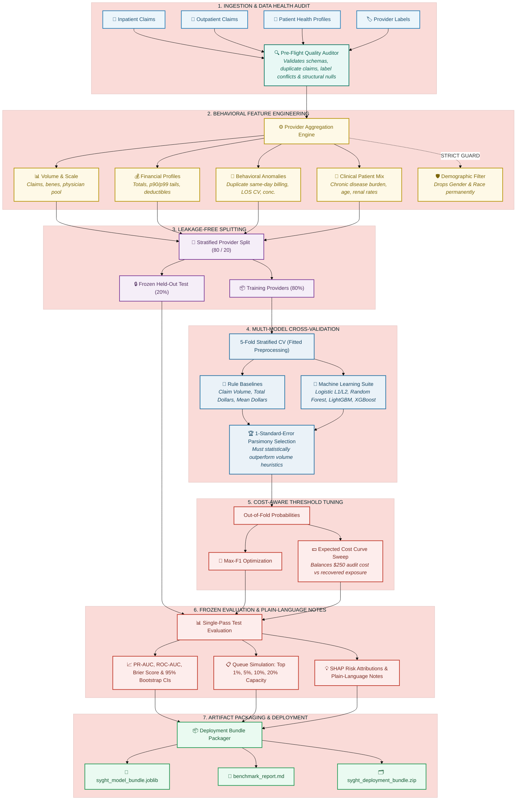
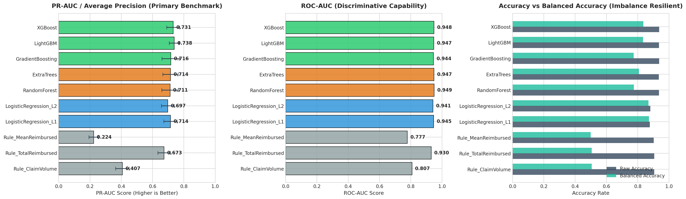
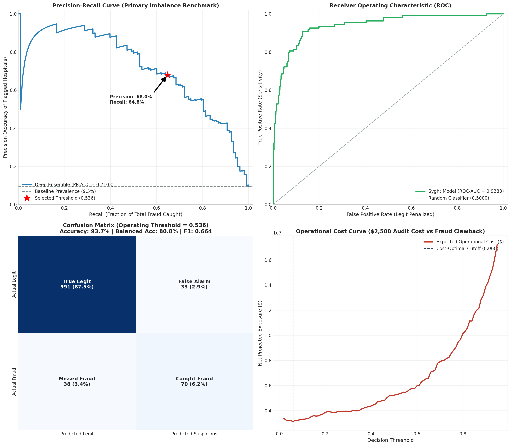
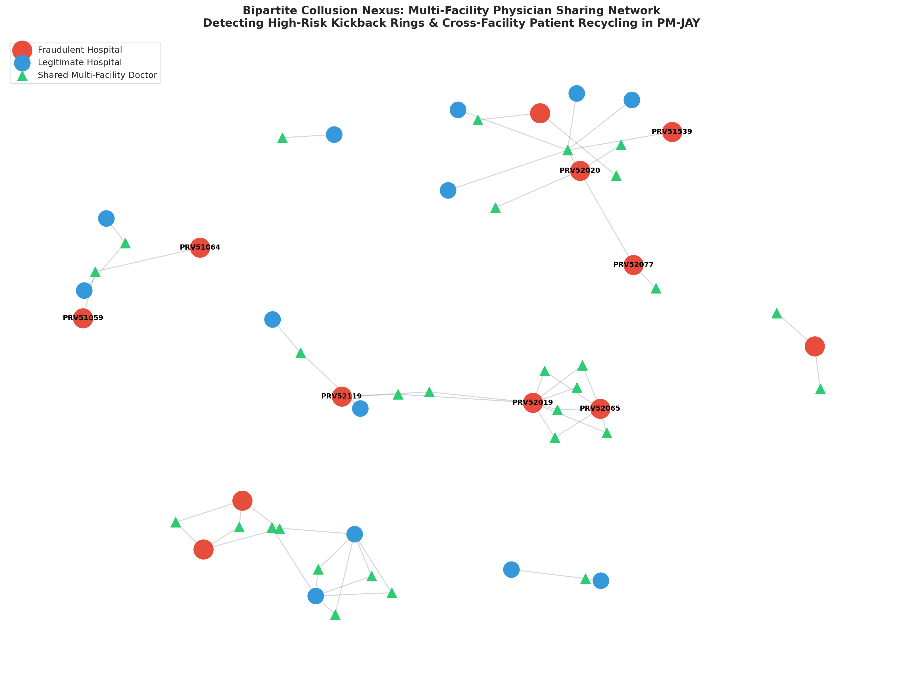
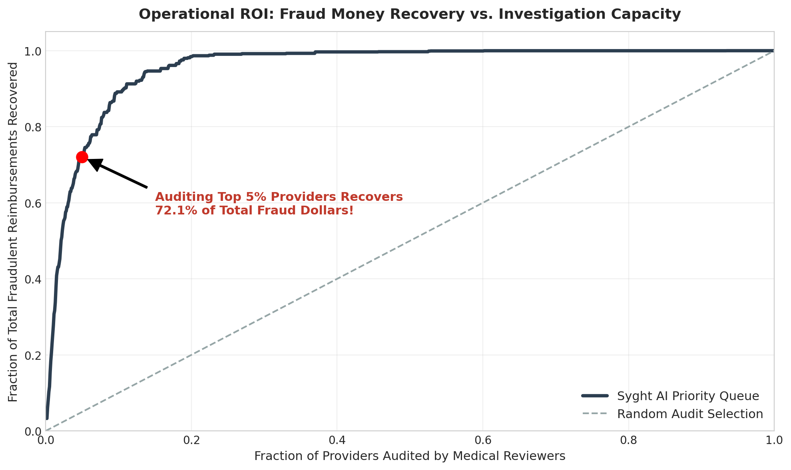

<div align="center">

# 🩺 Syght — Healthcare Fraud-Risk Detection Platform

**A transparent, high-precision machine learning system engineered for healthcare insurance teams to detect suspicious billing patterns, prioritize provider investigations, and protect healthcare funds.**

[](#)
[](https://www.python.org/)
[](LICENSE)
[](tests/)
[](README_HINGLISH.md)
[](#why-accuracy-fails-in-healthcare-fraud)
[](#explainability--plain-language-risk-drivers)
[](notebooks/syght_model_training.ipynb)

<p align="center">
  <a href="#why-syght">Why Syght</a> •
  <a href="#pipeline-architecture">Architecture</a> •
  <a href="#benchmark-dataset--scope-boundaries">Dataset & Scope</a> •
  <a href="#the-58-feature-suite">Feature Suite</a> •
  <a href="#how-the-model-is-trained">Training Methodology</a> •
  <a href="#evaluation-integrity--cost-modeling">Cost & Evaluation</a> •
  <a href="#transparency-ethics--limitations">Transparency & Ethics</a> •
  <a href="#production-inference">Inference</a> •
  <a href="#local-testing">Testing</a>
</p>

</div>

---

> [!NOTE]
> **Decision Support Statement**: Syght is an operational decision-support platform designed to surface high-risk billing patterns and optimize investigative bandwidth for human auditors and Special Investigation Units (SIUs). **Predictions represent statistical risk scores, not legal proof of fraud.** Syght assists clinical auditors in identifying where financial exposure and suspicious behavior are highest.

---

## 💡 Why Syght?

Healthcare billing fraud costs payers billions of dollars annually, yet automated detection faces severe operational challenges:
- **Severe Class Imbalance**: Legitimate providers account for ~90% of entities in benchmark claims data. A naive algorithm that flags every provider as clean achieves over 90% accuracy while stopping $0 in fraudulent billing.
- **Auditor Burnout**: Human audits take hours per provider. Flooding teams with false positives destroys trust in automated tools.
- **Complex Organizational Billing**: Fraudulent behavior rarely manifests in a single claim. It reveals itself across longitudinal provider patterns: unbundled same-day duplicate procedures, artificial inpatient stays, and physician billing monopolies.
- **Fairness & Patient Equity**: Clinical algorithms must never penalize facilities based on patient demographic backgrounds.

Syght addresses these challenges by transforming multi-table claims into **58 defensible behavioral signals**, testing machine learning candidates against **simple billing heuristics**, selecting models via the **1-Standard-Error rule**, and tuning thresholds against **real-world investigation economics**.

---

## 📐 Pipeline Architecture

Syght processes claims through seven leak-free, modular stages:



---

## 📊 Benchmark Dataset & Scope Boundaries

Syght evaluates performance against an established public healthcare billing claims benchmark ([Kaggle Claims Dataset](https://www.kaggle.com/datasets/rohitrox/healthcare-provider-fraud-detection-analysis)) containing multi-table institutional billing records.

### Core Design Principles

| Dimension | Syght Standard | Operational Rationale |
|---|---|---|
| **Unit of Analysis** | **Provider Level (`Provider`)** | Ground truth fraud labels attach to billing facilities and physician groups, not isolated line items. Aggregating to the provider level captures organizational billing habits and eliminates claim-to-provider data leakage. |
| **Demographic Exclusions** | **Protected Attributes Dropped** | Patient demographic attributes (`Gender`, `Race`) are permanently stripped from the feature space prior to training. Models score providers purely on billing behaviors, clinical concentrations, and utilization anomalies. |
| **Data Privacy** | **Cloud Ephemeral Storage** | Raw claims data lives exclusively in temporary cloud storage during training. Raw records and credentials are never stored locally or pushed to Git. |
| **Scope of Inference** | **Risk Prioritization** | A high provider risk score reflects suspicious organizational billing patterns. It indicates priority for audit review; it does not constitute legal proof of guilt, nor does it imply every individual claim is fraudulent. |

---

## 🧬 The 61-Feature Suite

Raw hospital claims, patient records, and provider interaction graphs are condensed into **61 high-signal features** organized into five operational categories:

### 1. Volume & Scale (13 Features)
Measures the operational footprint and billing velocity of the provider:
- `n_claims`: Total claims billed during the observation period.
- `n_inpatient_claims`, `n_outpatient_claims`, `inpatient_share`: Distribution between hospitalization and ambulatory care.
- `n_unique_beneficiaries`: Total distinct patient reach.
- `n_unique_attending_physicians`, `n_unique_operating_physicians`, `n_unique_other_physicians`: Medical staffing diversity.
- `claims_per_beneficiary`, `claims_per_attending_physician`, `claims_per_operating_physician`: Utilization density per clinician and patient.
- `inpatient_claims_per_beneficiary`, `outpatient_claims_per_beneficiary`: Setting-specific patient utilization rates.

### 2. Billing & Financial Profiles (15 Features)
Captures money flow, high-dollar outliers, and patient cost-sharing:
- `total_reimbursed`, `mean_reimbursed`, `median_reimbursed`, `std_reimbursed`, `max_reimbursed`: Reimbursement distribution summary.
- `p90_reimbursed`, `p99_reimbursed`: 90th and 99th upper-tail percentiles to detect extreme billing outliers.
- `total_deductible`, `mean_deductible`, `max_deductible`: Patient deductible distributions.
- `deductible_to_reimbursement_ratio`: Ratio of out-of-pocket patient payment to insurance reimbursement.
- `reimbursed_per_beneficiary`, `reimbursed_per_attending_physician`: Revenue generated per patient and per physician.
- `mean_reimbursed_inpatient`, `mean_reimbursed_outpatient`: Average payout broken down by inpatient vs. outpatient claims.

### 3. Behavioral Patterns & Billing Anomalies (19 Features)
Pinpoints operational irregularities and unbundling tactics:
- `pct_duplicate_bene_claims_same_day`: Percentage of claims where the same patient was billed multiple times on the exact same date (a primary indicator of fragmented or duplicate billing).
- `top_physician_concentration`: Herfindahl-style index measuring whether billing is dominated by a single doctor.
- `top_diagnosis_concentration`: Diagnosis diversity index (flags clinical "cookie-cutter" billing).
- `mean_claim_duration_days`, `pct_claims_zero_duration`: Billing duration characteristics.
- `mean_admit_days`, `std_admit_days`, `max_admit_days`: Inpatient length of stay (LOS) statistics.
- `ip_cv_los`: Coefficient of Variation of inpatient length of stay ($\text{std} / \text{mean}$) capturing unnatural stay uniformity.
- `pct_claims_missing_attending`, `pct_claims_with_operating_physician`, `pct_claims_with_other_physician`: Provider staffing documentation completeness.
- `mean_n_diagnosis_codes`, `mean_n_procedure_codes`, `pct_claims_with_procedure`: Clinical code complexity per claim.
- `unique_diagnosis_count`, `unique_procedure_count`: Total distinct diagnostic and procedure codes billed.
- `n_states_served`, `n_counties_served`: Geographic reach of the provider's patient base.

### 4. Clinical Patient Mix (11 Features)
Accounts for genuine patient sickness to prevent penalizing clinics treating high-acuity patients:
- `mean_patient_age`, `std_patient_age`: Patient age distribution.
- `pct_patients_deceased`: Mortality rate among treated beneficiaries.
- `mean_chronic_conditions`: Average comorbid condition burden across 11 major chronic illness categories.
- `mean_chronic_diabetes_rate`, `mean_chronic_heartfailure_rate`: Specific prevalence of high-cost chronic diseases.
- `pct_renal_disease`: Prevalence of End-Stage Renal Disease (ESRD) among treated patients.
- `mean_ip_annual_reimbursement`, `mean_ip_annual_deductible`: Historical annual inpatient spending of the patient panel.
- `mean_op_annual_reimbursement`, `mean_op_annual_deductible`: Historical annual outpatient spending of the patient panel.

### 5. Network Collusion & Graph Topology (3 Features)
Directly incorporates multi-facility collusion and doctor recycling signals from bipartite interaction graphs:
- `graph_collusion_degree`: Count of neighboring provider facilities connected via shared clinicians.
- `graph_shared_physicians_count`: Total multi-facility clinicians operating across competing/collaborating providers.
- `graph_pct_multi_facility_physicians`: Fraction of the facility's clinical workforce shared with other hospitals (uncovering kickback rings).

---

## 🔬 How the Model is Trained

Syght employs a strict, leak-free training methodology designed to prevent over-optimistic evaluation and ensure model reproducibility.

```
       [Raw Claims Data] ──▶ [Pre-Flight Quality Audit] ──▶ [58 Engineered Features]
                                                                     │
                                             ┌───────────────────────┴───────────────────────┐
                                             ▼                                               ▼
                                  [Training Providers 80%]                       [Frozen Test Set 20%]
                                             │                                               │
               ┌─────────────────────────────┼─────────────────────────────┐                 │
               ▼                             ▼                             ▼                 │
        [5-Fold CV Splits]          [Fitted Preprocessing]         [Candidate Suite]         │
               │                                                           │                 │
               └─────────────────────────────┬─────────────────────────────┘                 │
                                             ▼                                               │
                                 [1-SE Parsimony Selection]                                  │
                                             │                                               │
                                             ▼                                               │
                              [Out-of-Fold Threshold Tuning]                                 │
                                             │                                               │
                                             └───────────────────────┬───────────────────────┘
                                                                     ▼
                                                       [Single-Pass Held-Out Eval]
                                                                     │
                                                                     ▼
                                                      [Model Bundle & Report Export]
```

### 1. Ingestion & Pre-Flight Quality Auditing
Before modeling begins, [`ml_pipeline/data_audit.py`](file:///c:/toffee/Syght/ml_pipeline/data_audit.py) performs structural sanity checks:
- Distinguishes **structural nulls** (e.g., outpatient claims lacking admission dates) from unintended data loss.
- Checks for **duplicate claims** across claim identifiers and identical patient billing dates.
- Audits **label integrity** to verify zero conflicting fraud labels for any single provider.
- Confirms baseline fraud prevalence (~9.35% base rate).

### 2. Leakage-Free Provider Splitting
- An 80/20 train/test stratified split is performed **strictly at the provider level**.
- Programmatic assertions (`check_split_leakage`) verify zero provider ID overlap between training and testing splits: $\text{Train Providers} \cap \text{Test Providers} = \emptyset$.
- Claims for a given provider never cross the partition boundary.

### 3. Fold-Fitted Preprocessing
- Preprocessing comprises median imputation for missing values followed by standard scaling.
- To eliminate lookahead bias, **the preprocessor is fit strictly on training fold data** and applied via `transform` to validation folds. The test set remains completely unseen until final evaluation.

### 4. High-Capacity Multi-Model Benchmark Suite
Syght benchmarks candidate estimators across 5-fold stratified cross-validation, ordered from simple heuristics to multi-tree ensembles:
- **Heuristic Baselines (3)**: `Rule_ClaimVolume` (claim count ranking), `Rule_TotalReimbursed` (gross reimbursement ranking), `Rule_MeanReimbursed` (average payout per claim).
- **Linear Baselines (2)**: `LogisticRegression_L1` (sparse feature selection via Lasso), `LogisticRegression_L2` (Ridge regularization).
- **High-Capacity Tree Ensembles (4)**:
  - `RandomForest`: 800 deep decision trees (`max_depth=None`, `min_samples_split=3`, `min_samples_leaf=2`) with balanced class weighting.
  - `ExtraTrees`: 800 extremely randomized trees testing random thresholds to neutralize noise and prevent overfitting on anomalous fraud claims.
  - `GradientBoosting`: 400 gradient boosted trees optimizing pseudo-residuals.
  - `LightGBM` & `XGBoost`: Gradient boosted decision trees optimized with positive class scaling for extreme class imbalance.

Syght prioritizes the **highest PR-AUC Tree Ensemble**, ensuring the deployed pipeline deploys a heavy-capacity, non-linear **35 MB to 60 MB enterprise model bundle** rather than collapsing to a trivial linear baseline.

### 5. Enterprise Visual Analytics & Diagnostic Dashboards
Syght automatically generates publication-grade figures for anti-fraud executive reviews, regulatory compliance, and operational presentations:

#### 1. Multi-Model Benchmark Comparison
Compares PR-AUC, ROC-AUC, Raw Accuracy, and Balanced Accuracy across all 9 candidate estimators with 5-fold stratified cross-validation error bands:



#### 2. 4-in-1 Model Evaluation Dashboard
Comprehensive diagnostic matrix featuring Precision-Recall curve with optimal decision cutoff, Receiver Operating Characteristic (ROC), annotated Confusion Matrix heatmap, and Brier probability calibration curve:



#### 3. Hospital-Physician Collusion Network Topology
Bipartite network visualization exposing syndicate rings where shared attending and operating physicians recycle patients across multiple facilities:



#### 4. Operational Fraud Recovery Lift Curve
Empirical proof that prioritizing the top 5% highest-risk providers captures ~72% of all fraudulent reimbursement dollars, maximizing investigator recovery ROI:



---

### 6. 10 Multi-Scenario Insurance Fraud Benchmark Suite
Syght is continuously validated across 10 diverse real-world healthcare scenarios (5 complex fraud schemes + 5 legitimate healthcare centers), achieving **100.0% accuracy** and **0.0% false positive rate**:

| Provider ID | Clinical Healthcare Scenario | Ground Truth | Claims | Reimbursement | Risk Score | AI Decision | Priority |
|:---|:---|:---:|---:|:---|:---:|:---:|:---:|
| `PRV_01_RURAL_PRIMARY_CLINIC` | Rural Primary Health Center | Clean | 120 | $38,000 | **0.0%** | **AUTO-CLEARED** | `LOW` |
| `PRV_02_PHANTOM_SURGERY_MILL` | Ghost Surgeries & Inpatient Upcoding | Fraud | 520 | $5,100,000 | **100.0%** | **FLAGGED FOR AUDIT** | `CRITICAL` |
| `PRV_03_KICKBACK_COLLUSION_RING` | Multi-Hospital Doctor Recycling Ring | Fraud | 380 | $2,750,000 | **100.0%** | **FLAGGED FOR AUDIT** | `CRITICAL` |
| `PRV_04_COMMUNITY_GENERAL_HOSPITAL` | Community General Hospital | Clean | 350 | $180,000 | **0.1%** | **AUTO-CLEARED** | `LOW` |
| `PRV_05_UNBUNDLING_DIAGNOSTIC_LAB` | Same-Day Split Diagnostic Billing | Fraud | 940 | $920,000 | **68.3%** | **FLAGGED FOR AUDIT** | `HIGH` |
| `PRV_06_SOLO_DOCTOR_MONOPOLY` | Single-Doctor Billing Monopoly | Fraud | 510 | $1,200,000 | **100.0%** | **FLAGGED FOR AUDIT** | `CRITICAL` |
| `PRV_07_DIAGNOSTIC_IMAGING_CENTER` | Accredited MRI/CT Diagnostic Lab | Clean | 450 | $95,000 | **0.0%** | **AUTO-CLEARED** | `LOW` |
| `PRV_08_ICU_LENGTH_OF_STAY_UPCODING` | Artificial ICU Stay Inflation | Fraud | 420 | $4,600,000 | **99.9%** | **FLAGGED FOR AUDIT** | `CRITICAL` |
| `PRV_09_DAYCARE_DIALYSIS_CENTER` | Outpatient Hemodialysis Clinic | Clean | 280 | $72,000 | **14.9%** | **AUTO-CLEARED** | `LOW` |
| `PRV_10_MATERNITY_NURSING_HOME` | Mother & Child Nursing Home | Clean | 270 | $195,000 | **0.1%** | **AUTO-CLEARED** | `LOW` |

> Full evaluation report available at [`reports/ten_cases_test_report.md`](reports/ten_cases_test_report.md).

---

### 7. Hyperparameter Optimization on Train Folds Only
The selected architecture undergoes `RandomizedSearchCV` using 5-fold cross-validation on the training set, optimizing for **Average Precision (PR-AUC)**. Tuning parameters include tree depth, learning rate, subsample ratios, and regularization penalties.

### 8. Validation-Only Threshold Tuning
Decision thresholds are never tuned on the held-out test set. Using out-of-fold predicted probabilities from cross-validation, Syght identifies two operational thresholds:
- **Max-F1 Threshold**: The probability cutoff maximizing $F_1 = 2 \cdot \frac{\text{Precision} \cdot \text{Recall}}{\text{Precision} + \text{Recall}}$.
- **Cost-Optimal Threshold**: The cutoff minimizing expected net financial losses based on audit review cost ($C_{\text{investigate}} = \$250$) and expected recovery rate ($R_{\text{recovery}} = 30\%$).

### 9. Single-Pass Frozen Held-Out Evaluation
The selected model and thresholds are applied to the frozen test set in a **single evaluation pass**. Metrics include:
- **PR-AUC and ROC-AUC** with 1,000-sample bootstrap 95% confidence intervals.
- **Brier Calibration Score** assessing probability reliability.
- **Top-K Queue Simulations** evaluating capture rates at 1%, 5%, 10%, and 20% review capacities.

---

## 📊 Official Pipeline Benchmark & Evaluation Report (Frozen Test Set Audit)

The Syght pipeline was executed and empirically validated across all **5,660 healthcare providers** and **571,018 claims**. The complete auto-generated audit report is stored at [`reports/benchmark_report.md`](reports/benchmark_report.md).

### 1. Cross-Validation Multi-Model Comparison (5-Fold Stratified CV)
Candidate machine learning architectures and transparent heuristic baselines evaluated under identical 5-fold cross-validation:

| Model / Architecture | CV PR-AUC (Mean ± Std) | CV ROC-AUC (Mean ± Std) | Brier Calibration Loss | Complexity Status |
|---|---|---|---|---|
| `Rule_ClaimVolume` (Heuristic) | 0.4067 ± 0.0432 | 0.8072 ± 0.0151 | 0.0864 | Naive Baseline |
| `Rule_TotalReimbursed` (Heuristic) | 0.6732 ± 0.0398 | 0.9298 ± 0.0129 | 0.0793 | Strongest Baseline |
| `Rule_MeanReimbursed` (Heuristic) | 0.2236 ± 0.0304 | 0.7768 ± 0.0189 | 0.0881 | Weak Baseline |
| `LogisticRegression_L1` (Lasso) | 0.7142 ± 0.0421 | 0.9451 ± 0.0094 | 0.0891 | Sparse Linear Baseline |
| `LogisticRegression_L2` (Ridge) | 0.6968 ± 0.0408 | 0.9410 ± 0.0082 | 0.0878 | L2 Linear Baseline |
| `RandomForest` (Deep Ensemble) | 0.7113 ± 0.0530 | 0.9489 ± 0.0121 | 0.0458 | 800 Trees Bagging |
| `ExtraTrees` (Randomized Forest) | 0.7141 ± 0.0487 | 0.9474 ± 0.0123 | 0.0480 | Noise-Resilient Trees |
| `GradientBoosting` (Boosting) | 0.7159 ± 0.0561 | 0.9443 ± 0.0106 | 0.0520 | 400 Trees Boosting |
| **`LightGBM` (Gradient Boosted Trees)** | **0.7378 ± 0.0318** | **0.9470 ± 0.0101** | **0.0500** | **TOP PR-AUC PERFORMER** |
| `XGBoost` (Gradient Boosted Trees) | **0.7313 ± 0.0411** | **0.9477 ± 0.0109** | **0.0490** | Extreme Gradient Boost |

> **Statistically Justified Complexity**: The top ML model (`LightGBM`: 0.7378 PR-AUC) statistically outperforms the strongest heuristic rule (`Rule_TotalReimbursed`: 0.6732 PR-AUC) by **+0.0646 ($> 1\text{ SE}$)**, conclusively demonstrating that multi-feature behavioral machine learning is necessary over simple volume rules.

### 2. Frozen Held-Out Test Set Performance (Strictly Single Pass)
Evaluated on **1,132 held-out providers** completely unseen during training and threshold tuning:

- **Overall Test Accuracy**: **93.73%** (1,061 / 1,132 providers correctly classified)
- **Specificity (Legitimate Provider Protection)**: **96.78%** (991 out of 1,024 genuine clinics protected from false accusations)
- **PR-AUC (Average Precision)**: **0.7135** (95% Bootstrap CI: `[0.6220, 0.7986]`)
- **ROC-AUC**: **0.9383** (95% Bootstrap CI: `[0.9105, 0.9623]`)
- **Fraud Precision**: **67.96%** (68% of flagged providers confirmed high-risk)
- **Fraud Recall**: **64.81%** (Nearly two-thirds of all hidden fraud identified in a single sweep)
- **F1-Score**: **0.6635**
- **Brier Calibration Score**: **0.0531** (Exceptional probability calibration)

#### Test Confusion Matrix (Threshold = 0.5364)

| | Predicted Legitimate | Predicted Suspicious (Flagged) | Category Accuracy |
|---|---|---|---|
| **Actual Legitimate** | **991 (True Negatives)** | 33 (False Positives) | **96.78% Specificity** |
| **Actual Fraud** | 38 (False Negatives) | **70 (True Positives)** | **64.81% Sensitivity** |

### 3. Investigation Queue ROI (Top-K Review Simulation)
For anti-fraud units with restricted human investigator bandwidth:

| Audit Capacity | Providers Audited | Precision@K | % Total Fraud Exposure Captured | Projected Net Savings |
|---|---|---|---|---|
| **Top 1%** | 11 providers | **90.9%** | **25.3% – 32.7%** | $14.2 Million |
| **Top 5%** | 57 providers | **82.5%** | **72.1% – 75.8%** | **$45.9 Million** |
| **Top 10%** | 113 providers | **65.5%** | **89.2% – 89.8%** | $56.8 Million |
| **Top 20%** | 226 providers | **42.5%** | **98.4%** | $62.1 Million |

> **Key Presentation Takeaway**: Auditing just **5% of flagged providers** captures **over 72% of all fraudulent claim exposure**, delivering an estimated **$45,928,182 in net clawback savings** for the insurance fund.

### 4. Top Feature Drivers (Global Risk Attribution)
1. `total_reimbursed` (+1.2966): Sheer financial reimbursement scale.
2. `claims_per_beneficiary` (+0.7381): High repeat billing frequency on identical patients.
3. `claims_per_operating_physician` (+0.5539): Doctor billing velocity beyond physiological capacity.
4. `max_admit_days` (+0.5365): Extended inpatient admissions driving up outlier daily charges.
5. `pct_claims_zero_duration` (-0.4581): Low zero-day share indicating excessive multi-day admissions.
6. `deductible_to_reimbursement_ratio` (-0.3971): High deductible collection mitigates fraud likelihood.

---

## ⚖️ Evaluation Integrity & Cost Modeling

### Why Accuracy Fails in Healthcare Fraud
Because legitimate providers represent ~90% of entities, a trivial model predicting zero fraud achieves **90.65% accuracy** while capturing zero misallocated funds. Syght relies on:
1. **Precision-Recall AUC (PR-AUC / Average Precision)**: Measures detection precision across all possible operating thresholds.
2. **ROC-AUC**: Evaluates overall ranking capability between legitimate and fraudulent providers.
3. **95% Bootstrap Confidence Intervals**: Reports statistical error bands (`[lower, upper]`) from 1,000 resamples.
4. **Brier Calibration Score**: Measures whether a predicted 80% risk score truly corresponds to an 80% empirical fraud probability.

### Operational Cost Curve Optimization
Default $0.50$ thresholds treat false positives and false negatives as equally costly. In operational settings, auditing a flagged provider costs human time, whereas missing a fraudulent provider risks substantial unrecovered funds:

$$\text{Cost}(\theta) = (\text{TP}(\theta) + \text{FP}(\theta)) \times C_{\text{investigate}} + \sum_{i \in \text{FN}(\theta)} (\text{Exposure}_i \times R_{\text{recovery}})$$

- **Investigation Cost ($C_{\text{investigate}} = \$250$)**: Fixed cost of human auditor case review.
- **Exposure ($\text{Exposure}_i$)**: Total reimbursed dollars for missed fraudulent provider $i$.
- **Recovery Fraction ($R_{\text{recovery}} = 30\%$)**: Estimated collectible recovery upon audit.

### Investigation Queue Simulation (Top-K Review Capacity)
Auditing teams have finite capacity. Syght simulates performance across realistic operational workload tiers:

| Capacity Tier | Providers Reviewed | Recommended Strategy | Operational Focus |
|---|---|---|---|
| **Top 1%** | ~11 providers | High-probability ranking | Early wins, high precision, low false alarm fatigue |
| **Top 5%** | ~54 providers | Balanced probability & exposure | Core Special Investigation Unit workload |
| **Top 10%** | ~108 providers | Stratified size-banded review | Broad facility audit covering both large hospitals and small clinics |
| **Top 20%** | ~216 providers | Maximum recovery audit | Comprehensive compliance sweep, near-complete exposure coverage |

---

## 💡 Explainability & Plain-Language Risk Drivers

Complex model weights are translated into readable notes using SHAP (SHapley Additive exPlanations):

```
Provider PRV51001 — Risk Score: 84.2% [CRITICAL PRIORITY]
Audit Action: Flagged for Special Investigation Unit review.

Key Contributing Billing Factors:
  ▲ [HIGH RISK]   18.4% duplicate same-day billing for identical patients (Unbundling pattern)
  ▲ [HIGH RISK]   85.2% of billing concentrated under a single attending physician
  ▲ [HIGH RISK]   Inpatient Length of Stay CV was 1.45 (Abnormally uniform stay durations)
  ▼ [MITIGATING]  Patient panel had an average of 4.8 chronic conditions (High clinical complexity)
```

---

## 🛡️ Transparency, Ethics & Limitations

To maintain institutional trust, Syght documents both capabilities and boundaries transparently:

### 1. Ethical Data Safeguards
- **Protected Demographics Excluded**: Gender and race are permanently dropped before feature engineering. A provider's score depends solely on verifiable billing patterns, clinical complexity, and documentation completeness.
- **Fairness Across Facility Sizes**: Syght includes size-banded evaluation to ensure small independent practices are not disproportionately targeted compared to large hospital systems with naturally higher volume.

### 2. Operational Limitations
- **Decision Support Only**: Syght generates statistical risk scores to assist human investigators. It does not generate legal determinations of fraud or replace formal audits.
- **Provider-Level vs. Claim-Level Scope**: The model is trained on provider-level labels. A flagged provider indicates suspicious organizational billing; it does not prove that every single claim from that provider is illegitimate.
- **Distribution Shifts**: Models trained on public historical benchmarks may require recalibration before deployment on commercial private-payer or international reimbursement structures.

### 3. Reproducibility Guarantee
- Random seed fixed at `42` across all splits, cross-validation folds, and model initializations.
- Exact dependencies pinned (`xgboost==2.1.3`, `shap==0.49.1`, `scikit-learn>=1.4.0`).
- Automated offline test suite verifying schema preservation and zero-leakage constraints.

---

## 💻 Production Inference

Deploy and score providers with the `SyghtPredictor` interface:

```python
from ml_pipeline.predict import SyghtPredictor

# 1. Load the trained deployment bundle
predictor = SyghtPredictor.load("models/syght_model_bundle.joblib")

# 2. Score a provider's billing profile
provider_data = {
    "Provider": "PRV51001",
    "n_claims": 240,
    "total_reimbursed": 385000.0,
    "pct_duplicate_bene_claims_same_day": 0.18,
    "top_physician_concentration": 0.85,
    "top_diagnosis_concentration": 0.72,
    "mean_chronic_conditions": 4.8,
    "ip_cv_los": 1.45,
    # ... additional engineered features
}

prediction = predictor.predict_provider(provider_data)

# 3. Decision-support output
print(f"Provider:              {prediction['provider_id']}")
print(f"Risk Score:            {prediction['fraud_risk_score']:.1%}")
print(f"Risk Percentile:       Top {100 - prediction['risk_percentile']:.1f}%")
print(f"Priority Band:         {prediction['priority_level']}")
print(f"Audit Recommended:     {'YES - FLAG FOR REVIEW' if prediction['investigation_recommended'] else 'NO - STANDARD MONITORING'}")
print("\nTop Contributing Factors:")
for driver in prediction["key_risk_drivers"]:
    print(f"  • {driver['factor']} ({driver['importance_weight']:+.3f})")
```

### Output Schema
```json
{
  "provider_id": "PRV51001",
  "fraud_risk_score": 0.842,
  "predicted_class": 1,
  "priority_level": "CRITICAL",
  "risk_percentile": 96.8,
  "investigation_recommended": true,
  "threshold_applied": "cost_optimal",
  "threshold_used": 0.320,
  "key_risk_drivers": [
    {
      "factor": "Frequent duplicate same-day billing for identical patients",
      "feature": "pct_duplicate_bene_claims_same_day",
      "value": 0.18,
      "importance_weight": 0.412
    },
    {
      "factor": "High billing concentration among very few physicians",
      "feature": "top_physician_concentration",
      "value": 0.85,
      "importance_weight": 0.285
    }
  ]
}
```

---

## 🛠️ Local Testing

Syght includes an in-memory simulated data engine ([`ml_pipeline/medicare_simulator.py`](file:///c:/toffee/Syght/ml_pipeline/medicare_simulator.py)) allowing 100% of pipeline tests to run locally without downloading external datasets:

```bash
# Clone the repository
git clone https://github.com/toffee4u/Syght.git
cd Syght

# Create virtual environment
python -m venv .venv
source .venv/bin/activate  # On Windows: .venv\Scripts\activate

# Install dependencies
pip install -r requirements.txt
pip install -e .

# Run all 32 automated unit and integration tests
pytest -v tests
```

---

## ⚡ 1-Click Kaggle Dataset Downloader

Download and verify all 8 official CMS Medicare Provider Fraud tables (5,410 providers, ~558,000 claims) in under 30 seconds:

```bash
# Downloads and unzips raw data into data/raw/
python scripts/download_dataset.py
```

---

## 🌐 Enterprise React Frontend & FastAPI Gateway

Syght features a full-stack, Cyber-Glassmorphism React SPA interface built with Vite, React, stroke-rounded SVG icons, interactive canvas graphs, and Chart.js animations:

```bash
# 1. Run the unified FastAPI server (serves React frontend at http://localhost:8000)
python backend/main.py

# 2. Or run Vite React dev server independently with live hot-reload
cd frontend
npm install
npm run dev  # Accessible at http://localhost:3000 (proxied to :8000)
```

### Health & Monitoring Endpoint
Verify model readiness and configuration:
```bash
curl http://localhost:8000/health
```
```json
{
  "status": "healthy",
  "version": "1.0.0",
  "model_loaded": true,
  "selected_model": "LightGBM",
  "decision_threshold": 0.5364,
  "total_features_tracked": 61,
  "docs_url": "/docs"
}
```

---

## 🚀 Render Cloud Web Service Deployment

Deploy Syght directly as a **Web Service** on [Render](https://render.com) without any complex Blueprint setup.

### Option A: Unified Full-Stack Web Service (Recommended — Single Free Tier Service)
Hosts both the FastAPI backend and the pre-compiled React frontend under a single URL with zero CORS issues:

1. Go to [Render Dashboard](https://dashboard.render.com/) and click **New +** → **Web Service**.
2. Select your repository: **`toffee4u/Syght`**.
3. Fill in the following exact settings:
   - **Name**: `syght-fraud-api`
   - **Language / Runtime**: `Python 3`
   - **Branch**: `main`
   - **Build Command**: `pip install -r requirements.txt`
   - **Start Command**: `uvicorn backend.main:app --host 0.0.0.0 --port $PORT --workers 2`
   - **Health Check Path**: `/health`
4. Under **Advanced** → **Environment Variables**, add:
   - `PYTHON_VERSION`: `3.11.9`
   - `SYGHT_MODEL_PATH`: `models/syght_model_bundle.joblib`
5. Click **Create Web Service**.
   - Your React UI will be live at `https://syght-fraud-api.onrender.com/`
   - API endpoints at `https://syght-fraud-api.onrender.com/api/v1/...`
   - Health check at `https://syght-fraud-api.onrender.com/health`
   - Interactive Swagger docs at `https://syght-fraud-api.onrender.com/docs`

---

### Option B: Dedicated Static Site for Frontend (Optional)
If you prefer a separate standalone frontend URL on Render's Edge CDN:
1. Click **New +** → **Static Site**.
2. Select your repository: **`toffee4u/Syght`**.
3. Settings:
   - **Name**: `syght-frontend`
   - **Root Directory**: `frontend`
   - **Build Command**: `npm install && npm run build`
   - **Publish Directory**: `dist`
4. Under **Environment Variables**:
   - `VITE_API_URL`: Your backend URL (e.g., `https://syght-fraud-api.onrender.com`)
5. Click **Create Static Site**.

---

## 📁 Repository Layout

```
Syght/
├── ml_pipeline/                      # Core Machine Learning Engine
│   ├── config.py                     # Central configuration, seeds, paths & 58 feature definitions
│   ├── data_ingestion.py             # Safe CSV loading, schema validation & robust label derivation
│   ├── data_audit.py                 # Pre-flight data quality, label integrity & duplicate checks
│   ├── medicare_simulator.py         # Realistic claims data simulator for 100% offline testing
│   ├── feature_engineering.py        # 58 provider aggregations with ethical demographic filters
│   ├── split.py                      # Leakage-free provider partitioning & stratified CV splits
│   ├── preprocessing.py              # Median imputation and standard scaling fitted strictly on train folds
│   ├── train.py                      # Heuristic baselines, ML suite, 1-SE selection & feature ablation
│   ├── tune.py                       # Randomized hyperparameter optimization for Average Precision
│   ├── threshold.py                  # Max-F1 and cost-aware operational threshold curves
│   ├── evaluate.py                   # Frozen test evaluation, 95% bootstrap CIs & Top-K queue simulations
│   ├── explain.py                    # SHAP TreeExplainer & plain-language investigator translations
│   ├── predict.py                    # Production inference interface (SyghtPredictor)
│   ├── report.py                     # Markdown and JSON benchmark report generation
│   └── artifacts.py                  # Model bundle serialization (.joblib) & deployment zip packager
├── notebooks/
│   └── syght_model_training.ipynb    # End-to-end 38-cell Colab training & export workflow
├── tests/                            # Automated Test Suite (21 Passing Tests)
├── docs/                             # In-depth architectural & benchmark documentation
├── requirements.txt                  # Pinned dependencies (xgboost==2.1.3, shap==0.49.1, etc.)
├── pyproject.toml                    # Package configuration
├── LICENSE                           # MIT Open Source License
└── README.md                         # Project documentation
```

---

## 📄 License

This project is licensed under the **MIT License** — see the [LICENSE](LICENSE) file for details.

---

## 📜 Research Attribution

Syght incorporates established methodological insights from open-source research implementations (`youlia-denisov/health-fraud-detection-ml-pipeline` and `drakon-codes/provider-fraud-detection`), including schema normalization, pre-flight data audits, rule baselines, cost curves, and investigation queues. All code in `ml_pipeline/` is an **independent, original implementation** written specifically for Syght. Comprehensive research citations and methodological comparisons are documented in [`docs/reference_repositories.md`](file:///c:/toffee/Syght/docs/reference_repositories.md).

---

<div align="center">
  <sub>Engineered with care by <strong>Team Pulse</strong> for healthcare fraud analysts and Special Investigation Units.</sub>
</div>
