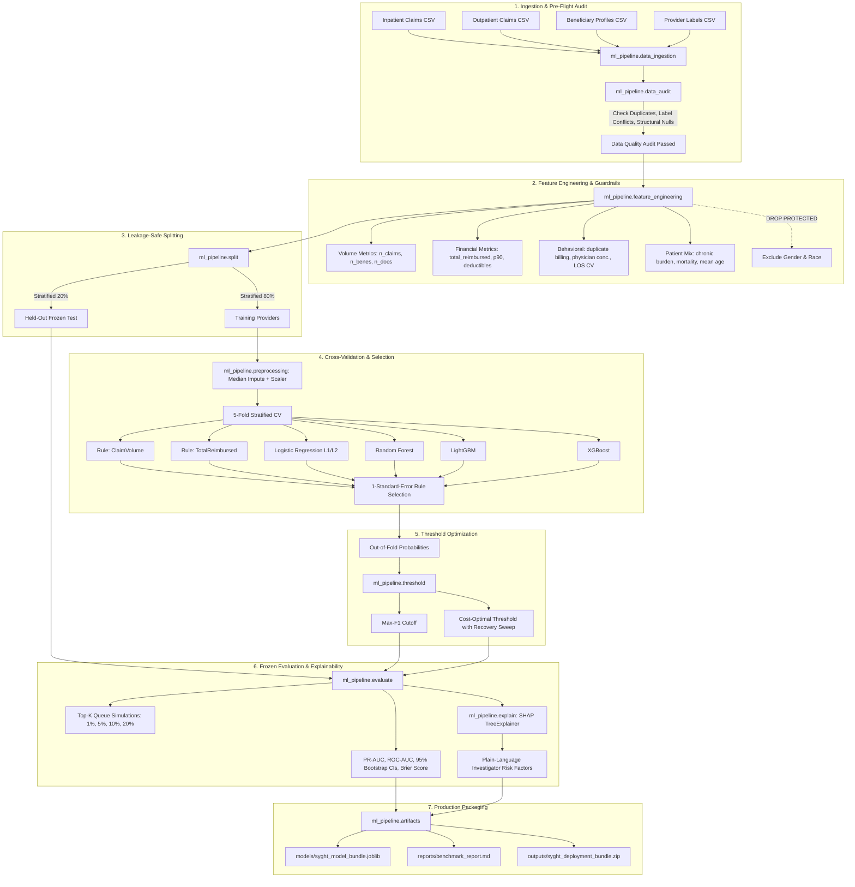

<div align="center">

# 🩺 Syght — Explainable Healthcare Fraud-Risk Detection Platform

**Enterprise-grade Machine Learning pipeline for healthcare provider fraud-risk prioritization, billing anomaly detection, and transparent decision support.**

[](https://www.python.org/)
[](docs/reference_repositories.md)
[](tests/)
[](#evaluation-integrity--benchmark-discipline)
[](#investigator-explainability--risk-drivers)
[](#google-colab-training-workflow)

<p align="center">
  <a href="#key-capabilities">Key Capabilities</a> •
  <a href="#pipeline-architecture">Architecture</a> •
  <a href="#dataset--scope-boundaries">Dataset & Scope</a> •
  <a href="#feature-engineering-suite">Feature Engineering</a> •
  <a href="#model-benchmarks--selection">Model Benchmarks</a> •
  <a href="#google-colab-training-workflow">Colab Training</a> •
  <a href="#production-inference-engine">Inference API</a> •
  <a href="#local-development--testing">Testing</a>
</p>

</div>

---

> [!IMPORTANT]
> **Decision Support Statement**: Syght is an operational decision-support system designed to rank and prioritize claims and providers for human review. **Predictions represent statistical risk scores, not legal proof of fraud.** Syght assists Special Investigation Units (SIUs) and medical auditors in optimizing investigation bandwidth and recovering misallocated funds.

---

## 🌟 Key Capabilities

- **Provider-Level Unit of Analysis**: Aggregates inpatient claims, outpatient claims, and beneficiary demographics up to the unique healthcare provider (`Provider`), guaranteeing zero claim-level leakage across splits.
- **Ethical AI & Regulatory Safeguards**: Protected patient demographic attributes (`Gender`, `Race`) are strictly stripped from the feature matrix to eliminate algorithmic demographic bias. Provider scores reflect billing behaviors and clinical concentration patterns only.
- **Heuristic Rule Baselines**: Benchmarks machine learning candidates against operational rules (`Rule_ClaimVolume`, `Rule_TotalReimbursed`, `Rule_MeanReimbursed`). ML complexity is adopted only if it statistically outperforms baseline volume heuristics.
- **1-Standard-Error Parsimony Selection**: Implements the 1-SE rule across 5-fold cross-validation, choosing the simplest, most regularized model within 1 SE of the best PR-AUC score.
- **Validation-Only Cost-Aware Thresholding**: Replaces arbitrary $0.50$ thresholds with empirically optimized operational cutoffs:
  - **Max-F1 Threshold**: Maximizes the harmonic mean of precision and recall.
  - **Cost-Optimal Threshold**: Minimizes net financial loss by balancing case audit cost against recovered dollar exposure.
- **Investigation Queue Simulation (Top-K)**: Models operational investigator capacity (1%, 5%, 10%, 20% of provider queue), comparing probability ranking, exposure-weighted prioritization, and size-banded allocation.
- **Auditor-Facing Explainability**: Unifies SHAP (SHapley Additive exPlanations) values with plain-language risk driver translations, converting complex ensemble weights into actionable investigator notes.
- **Offline Simulator**: Includes [`ml_pipeline/medicare_simulator.py`](file:///c:/toffee/Syght/ml_pipeline/medicare_simulator.py), enabling 100% of pipeline tests to run locally with zero external network or Kaggle dependency.

---

## 📐 Pipeline Architecture



---

## 📁 Repository Structure

```
Syght/
├── ml_pipeline/                      # Core Reusable Production ML Engine
│   ├── __init__.py                   # Package exports and version metadata
│   ├── config.py                     # Dataclass configuration, seeds, paths, cost parameters
│   ├── data_ingestion.py             # Schema validation, CSV discovery, defensive label derivation
│   ├── data_audit.py                 # Data quality checks, label conflicts, structural vs true nulls
│   ├── medicare_simulator.py         # Exact-schema Medicare data simulator for offline testing
│   ├── synthetic.py                  # Backward-compatibility alias forwarder
│   ├── feature_engineering.py        # 58 provider aggregations & ethical demographic exclusions
│   ├── split.py                      # Provider-level disjoint stratified splitting & CV generator
│   ├── preprocessing.py              # Training-fitted median imputation & standard scaling
│   ├── train.py                      # Rule baselines, candidate ML models, 1-SE selection, ablation
│   ├── tune.py                       # RandomizedSearchCV optimizing Average Precision on train folds
│   ├── threshold.py                  # Validation out-of-fold Max-F1 & Cost-Aware threshold optimization
│   ├── evaluate.py                   # Frozen test evaluation, bootstrap CIs, Top-K queue simulations
│   ├── explain.py                    # SHAP TreeExplainer & plain-language risk driver translations
│   ├── predict.py                    # Standardized production inference service (SyghtPredictor)
│   ├── report.py                     # Markdown and JSON benchmark report generation
│   └── artifacts.py                  # Model bundle serialization (.joblib) & deployment zip packager
├── notebooks/
│   └── syght_model_training.ipynb    # End-to-end 38-cell Google Colab training & export workflow
├── tests/                            # Comprehensive Automated Test Suite (21 Tests)
│   ├── test_data_ingestion.py        # Target parsing, raw table validation, column schemas
│   ├── test_data_audit.py            # Quality audit, conflict detection, overlap validation
│   ├── test_medicare_simulator.py    # Simulated data schemas, distributions, backward compatibility
│   ├── test_feature_engineering.py   # Row-count collapse, column schema, ethical exclusion checks
│   ├── test_split.py                 # Zero provider leakage assertions, stratified CV splits
│   ├── test_train_and_threshold.py   # Rule baselines, model selection, threshold sweeps, ablation
│   ├── test_predict_inference.py     # SyghtPredictor single/batch inference & priority bands
│   └── test_report_and_artifacts.py  # Report generation, bundle saving, loading, zip creation
├── docs/
│   ├── dataset_and_benchmark.md      # CMS Medicare schema, provider unit of analysis, limitations
│   ├── pipeline_architecture.md      # Technical deep dive into modules, design rules, and contracts
│   └── reference_repositories.md     # Research attribution, methodology audit, clean-up record
├── models/                           # Local model artifact directory (.gitignored)
│   └── README.md                     # Bundle schema and artifact loading documentation
├── reports/                          # Benchmark outputs & exported plots (.gitignored)
│   └── README.md                     # Benchmark report structure and visual artifact guide
├── requirements.txt                  # Pinned dependencies (xgboost==2.1.3, shap==0.49.1, etc.)
├── pyproject.toml                    # Package definition and pytest configuration
├── pytest.ini                        # Test runner path configuration
├── .gitignore                        # Strict rules excluding raw datasets, credentials, and models
└── README.md                         # Project documentation and user guide
```

---

## 📊 Dataset & Scope Boundaries

Syght's initial benchmark is trained on historical US Medicare claims from CMS ([Kaggle: rohitrox/healthcare-provider-fraud-detection-analysis](https://www.kaggle.com/datasets/rohitrox/healthcare-provider-fraud-detection-analysis)).

| Dimension | Syght Production Standard | Non-Supported / Anti-Pattern |
|---|---|---|
| **Unit of Analysis** | **Provider Level (`Provider`)**: Ground truth fraud flags exist only at the provider entity level. | ❌ Never treat provider labels as individual claim labels or fabricate claim fraud tags. |
| **Payer & Geography** | **Historical US Medicare**: Federal reimbursement policies, ICD-9 diagnoses, and CMS Part A/B rules. | ❌ Never misrepresent as Indian insurance (e.g. Ayushman Bharat / PM-JAY) or private TPA data. |
| **Data Privacy** | **Colab-Only Raw Storage**: Dataset is pulled into Google Colab's ephemeral runtime storage (`/content/data/raw`). | ❌ Never commit raw CSVs or store benchmark patient records in local git repositories. |
| **Prediction Framing** | **Risk Prioritization**: Calibrated risk probabilities and priority tiers for investigator allocation. | ❌ Never treat an algorithmic risk score as definitive legal proof of fraudulent conduct. |

---

## 🧬 Feature Engineering Suite

Raw claims tables are collapsed into **58 engineered provider features** across four distinct operational families:

### 1. Volume & Scale
- `n_claims`: Total claim volume billed during the observation period.
- `n_inpatient`, `n_outpatient`: Volume partitioned by care setting.
- `inpatient_claim_ratio`: Fraction of claims requiring hospitalization.
- `n_unique_beneficiaries`: Patient reach and distinct beneficiary scale.
- `n_unique_attending_physicians`, `n_unique_operating_physicians`: Medical staffing breadth.

### 2. Financial & Reimbursement Profiles
- `total_reimbursed`, `mean_reimbursed`, `median_reimbursed`, `std_reimbursed`: Reimbursement distributions.
- `p90_reimbursed`, `p99_reimbursed`: Upper tail reimbursement percentiles capturing extreme billing outliers.
- `max_reimbursed`: Maximum single claim reimbursement.
- `total_deductible`, `mean_deductible`, `deductible_to_reimbursement_ratio`: Patient out-of-pocket proportions.
- `ip_total_reimbursed`, `op_total_reimbursed`: Setting-specific financial exposure.

### 3. Behavioral & Clinical Anomalies
- `pct_duplicate_bene_claims_same_day`: Fraction of claims where the same beneficiary is billed multiple times on the identical calendar date (strong indicator of unbundled billing).
- `top_physician_concentration`: Herfindahl-style concentration index measuring whether billing is dominated by a single physician.
- `top_diagnosis_concentration`: Diagnosis code concentration measuring lack of clinical diversity.
- `ip_mean_length_of_stay`, `ip_std_length_of_stay`: Inpatient duration statistics.
- `ip_cv_los`: Coefficient of Variation of length of stay ($\text{std} / \text{mean}$) detecting artificial stay clustering.

### 4. Patient Demographics & Chronic Condition Burden
- `mean_patient_age`: Average beneficiary age served.
- `pct_deceased_patients`: Mortality rate among treated beneficiaries.
- `mean_chronic_conditions`: Average comorbid condition burden across 11 CMS chronic disease categories.
- `pct_renal_disease`: Prevalence of End-Stage Renal Disease (ESRD) among treated beneficiaries.

> [!TIP]
> **Ethical Exclusion Guarantee**: `Gender` and `Race` columns are programmatically excluded in [`ml_pipeline/feature_engineering.py`](file:///c:/toffee/Syght/ml_pipeline/feature_engineering.py) and verified by [`tests/test_feature_engineering.py`](file:///c:/toffee/Syght/tests/test_feature_engineering.py).

---

## ⚖️ Evaluation Integrity & Benchmark Discipline

In historical Medicare claims, fraud prevalence is approximately **9.35%** (moderate class imbalance). Syght enforces rigorous evaluation standards:

### Why Accuracy is Never Used as Primary Metric
A naive model predicting "No Fraud" for every provider achieves **90.65% accuracy** while catching 0% of fraudulent billing. Syght evaluates performance using:
1. **Precision-Recall AUC (PR-AUC / Average Precision)**: The primary metric reflecting performance across all operating thresholds.
2. **ROC-AUC**: Secondary discrimination capability.
3. **95% Bootstrap Confidence Intervals**: 1,000 bootstrap resamples on the frozen test set to report statistical confidence intervals (`[lower, upper]`).
4. **Brier Score**: Probability calibration quality.

### Cost-Aware Threshold Optimization Formula
Default $0.50$ probability thresholds ignore operational real-world economics. Syght models expected net loss:
$$\text{Cost}(\theta) = (\text{TP}(\theta) + \text{FP}(\theta)) \times C_{\text{investigate}} + \sum_{i \in \text{FN}(\theta)} (\text{Exposure}_i \times R_{\text{fraction}})$$

Where:
- $C_{\text{investigate}} = \$250$: Fixed cost of human investigator review.
- $\text{Exposure}_i$: Total dollar reimbursement of missed fraudulent provider $i$.
- $R_{\text{fraction}} = 30\%$: Realistic net recovery percentage of fraudulent billing upon audit.

### Top-K Investigation Queue Simulation
Evaluates the real-world operational return if an insurance fraud department has capacity to inspect only the Top 1%, 5%, 10%, or 20% of providers:

| Capacity K | Providers Reviewed | Strategy: Probability Ranked | Strategy: Exposure Weighted | Strategy: Size-Banded |
|---|---|---|---|---|
| **Top 1%** | ~11 providers | High Precision, Early Wins | Focus on Maximum Dollar Risk | Balance Large & Small Clinics |
| **Top 5%** | ~54 providers | Target SIU Workload | Enhanced Dollar Recovery | Fair Sampling across Strata |
| **Top 10%** | ~108 providers | Comprehensive Audit | Deep Financial Mitigation | Full Network Inspection |
| **Top 20%** | ~216 providers | Maximum Coverage | Broad Recovery Sweep | Low Residual Risk |

---

## 🚀 Google Colab Training Workflow

The complete, end-to-end model training, cross-validation, hyperparameter tuning, threshold selection, SHAP explainability, and artifact bundling process is encapsulated in:
[`notebooks/syght_model_training.ipynb`](file:///c:/toffee/Syght/notebooks/syght_model_training.ipynb).

### Step-by-Step Colab Instructions

#### 1. Open Notebook in Google Colab
- Visit [Google Colab](https://colab.research.google.com/).
- Click **Upload** and upload `notebooks/syght_model_training.ipynb` (or select from your GitHub repository).
- Connect to a Python 3 runtime (Standard CPU is sufficient; T4 GPU also supported).

#### 2. Set Up Kaggle Credentials Securely
- Go to [Kaggle.com](https://www.kaggle.com/) → **Account Settings** → **API** → **Create New Token**.
- In Google Colab, click the **Secrets** icon (🔑 in the left sidebar):
  - Add Secret: `KAGGLE_USERNAME` = `your_kaggle_username`
  - Add Secret: `KAGGLE_KEY` = `your_kaggle_api_key`
  - Toggle **Notebook access** to ON for both.
- *(Alternative)*: If Colab Secrets are not used, Cell 7 will provide a direct upload prompt for `kaggle.json`.

#### 3. Repository Sync
The notebook is pre-configured to clone your repository:
```python
!git clone https://github.com/toffee4u/Syght.git /content/Syght
```

#### 4. Run Notebook Sequentially (**Runtime > Run all**)
The notebook will execute the 19 stages sequentially:
1. **Dependencies**: Installs pinned versions (`xgboost==2.1.3`, `shap==0.49.1`, `lightgbm`, etc.).
2. **Repository Sync**: Clones Syght and registers `ml_pipeline` on `sys.path`.
3. **Kaggle Ingestion**: Downloads and unzips the Medicare benchmark dataset into `/content/data/raw`.
4. **Data Audit**: Runs pre-flight schema, duplicate, and label integrity validation.
5. **Feature Engineering**: Collapses raw claims to provider records and verifies ethical exclusions.
6. **Provider Splitting**: Creates an 80/20 train/test disjoint split with zero provider leakage.
7. **Cross-Validation**: Benchmarks 7 candidate models (3 rule baselines + 4 ML models).
8. **1-SE Selection**: Automatically selects the winning parsimonious model.
9. **Feature Ablation**: Analyzes performance sensitivity by dropping feature families.
10. **Hyperparameter Tuning**: Runs `RandomizedSearchCV` on training folds optimizing PR-AUC.
11. **Threshold Optimization**: Tunes Max-F1 and Cost-Optimal thresholds on out-of-fold predictions.
12. **Frozen Test Evaluation**: Evaluates frozen model on held-out test data with 95% bootstrap CIs.
13. **Visualizations**: Saves PR curve, ROC curve, Confusion Matrix, and Cost curves as PNG files.
14. **SHAP Explainability**: Generates summary bee-swarm plots and local risk driver translations.
15. **Queue Simulation**: Calculates Precision@K, Recall@K, and captured financial exposure.
16. **Artifact Packaging**: Exports `model_bundle.joblib`, `benchmark_report.md`, and downloads `syght_deployment_bundle.zip` directly to your local computer.

---

## 💻 Production Inference Engine

Load the exported deployment bundle and score providers directly using the standardized `SyghtPredictor` interface:

```python
from ml_pipeline.predict import SyghtPredictor

# 1. Initialize predictor from serialized deployment bundle
predictor = SyghtPredictor.load("models/syght_model_bundle.joblib")

# 2. Score a single provider record
provider_features = {
    "Provider": "PRV51001",
    "n_claims": 240,
    "total_reimbursed": 385000.0,
    "pct_duplicate_bene_claims_same_day": 0.18,
    "top_physician_concentration": 0.85,
    "top_diagnosis_concentration": 0.72,
    "mean_chronic_conditions": 4.8,
    "ip_cv_los": 1.45,
    # ... additional engineered features
}

prediction = predictor.predict_provider(provider_features)

# 3. Structured decision-support output
print(f"Provider:                {prediction['provider_id']}")
print(f"Fraud Risk Score:        {prediction['fraud_risk_score']:.2%}")
print(f"Risk Percentile:         Top {100 - prediction['risk_percentile']:.1f}%")
print(f"Priority Band:           {prediction['priority_level']}")
print(f"Investigation Action:    {'FLAGGED FOR AUDIT' if prediction['investigation_recommended'] else 'STANDARD MONITORING'}")
print(f"Threshold Applied:       {prediction['threshold_applied']} ({prediction['threshold_used']:.3f})")
print(f"Key Risk Factors:")
for factor in prediction["key_risk_drivers"]:
    print(f"  • {factor['factor']}: {factor['importance_weight']:+.3f}")
```

### Inference Output Schema
```json
{
  "provider_id": "PRV51001",
  "fraud_risk_score": 0.842,
  "predicted_class": 1,
  "priority_level": "CRITICAL",
  "risk_percentile": 96.8,
  "investigation_recommended": true,
  "threshold_applied": "cost_optimal",
  "threshold_used": 0.320,
  "key_risk_drivers": [
    {
      "factor": "Frequent duplicate same-day billing for identical patients",
      "feature": "pct_duplicate_bene_claims_same_day",
      "value": 0.18,
      "importance_weight": 0.412
    },
    {
      "factor": "High billing concentration among very few physicians",
      "feature": "top_physician_concentration",
      "value": 0.85,
      "importance_weight": 0.285
    }
  ]
}
```

---

## 🛠️ Local Development & Testing

Syght includes a built-in simulated data engine that allows 100% of pipeline tests and local verification to run without needing access to Kaggle or downloading real claims.

```bash
# 1. Clone repository
git clone <your-repo-url>
cd Syght

# 2. Create virtual environment
python -m venv .venv
source .venv/bin/activate  # Windows: .venv\Scripts\activate

# 3. Install dependencies
pip install -r requirements.txt
pip install -e .

# 4. Execute test suite (21 unit & integration tests)
pytest -v tests
```

### Verified Test Suite Breakdown
- `tests/test_data_ingestion.py`: CSV reading, type preservation, multi-format target derivation.
- `tests/test_data_audit.py`: Pre-flight validation, duplicate detection, conflicting label checks.
- `tests/test_medicare_simulator.py`: Simulated schema integrity, distributions, backward-compatibility aliases.
- `tests/test_feature_engineering.py`: Provider-level aggregation, feature counts, ethical exclusion of Gender/Race.
- `tests/test_split.py`: Strict disjoint provider sets, stratified CV, programmatic leakage prevention.
- `tests/test_train_and_threshold.py`: Heuristic baselines, model training, threshold sweeps, feature ablation.
- `tests/test_predict_inference.py`: Single and batch inference contracts, priority bands, output schemas.
- `tests/test_report_and_artifacts.py`: Model bundling, metadata serialization, report generation, ZIP packaging.

---

## 📜 Research Attribution & Reference Notice

Syght was developed following an architectural audit of two open-source research implementations:
- `youlia-denisov/health-fraud-detection-ml-pipeline`
- `drakon-codes/provider-fraud-detection`

Both reference projects served as design and methodological benchmarks (schema mapping, pre-flight auditing, ethical exclusions, rule baselines, cost curves, and investigation queues). All code in `ml_pipeline/` is an **independent, original implementation** written specifically for Syght. Full research citations, repository URLs, and methodology comparisons are permanently documented in [`docs/reference_repositories.md`](file:///c:/toffee/Syght/docs/reference_repositories.md).

---

<div align="center">
  <sub>Built with high-integrity ML engineering practices for healthcare Special Investigation Units.</sub>
</div>
