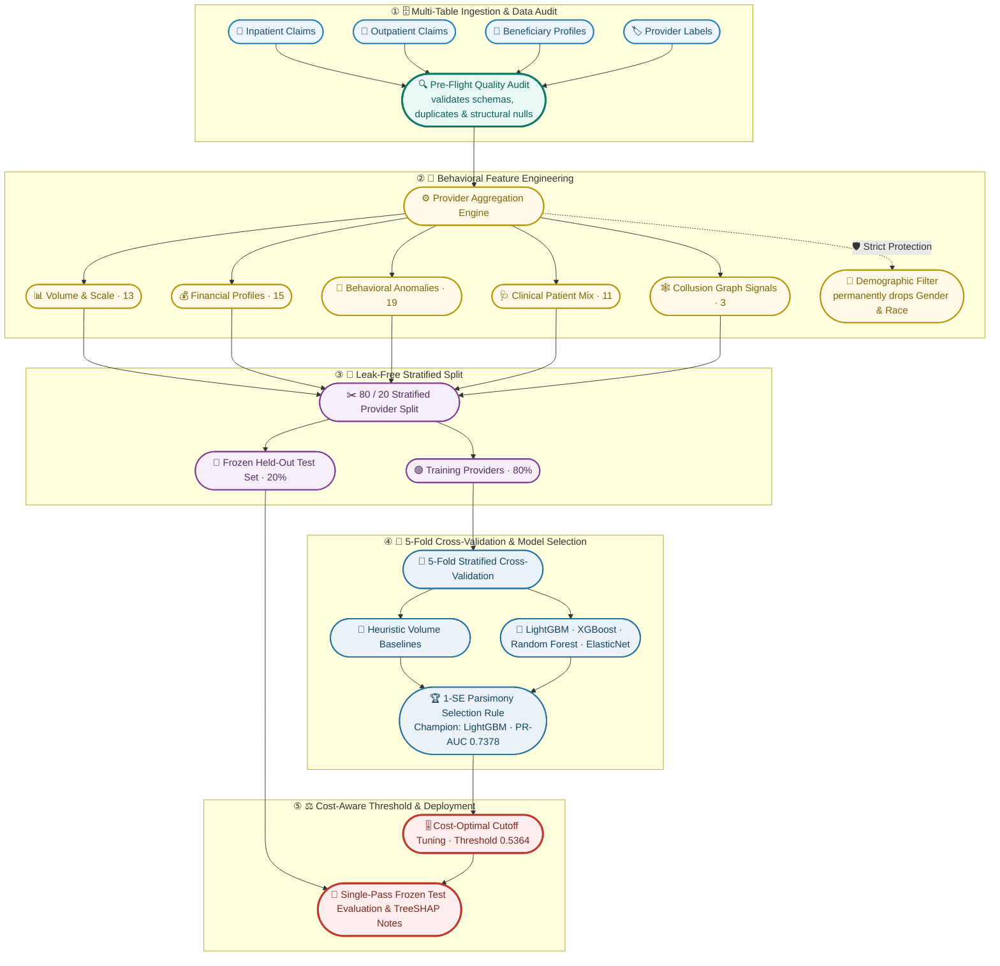

<div align="center">

# 🩺 Syght — Health Insurance Fraud Detector Platform

**A transparent, high-precision machine learning system engineered for healthcare insurance Special Investigation Units (SIUs) to detect suspicious billing patterns, uncover collusion rings, and intercept fraudulent claims in sub-5ms.**

[](#)
[](https://www.python.org/)
[](LICENSE)
[](tests/)
[](README_HINGLISH.md)
[](#-official-model-performance-frozen-test-set-audit)
[](#-official-model-performance-frozen-test-set-audit)
[](#-explainability--plain-language-risk-drivers)

<p align="center">
  <a href="#-why-syght">Why Syght</a> •
  <a href="#-datasets-used-for-training-evaluation--benchmarking">Datasets Used</a> •
  <a href="#-pipeline-architecture">Architecture</a> •
  <a href="#-the-61-feature-suite">Feature Suite</a> •
  <a href="#-official-model-performance-frozen-test-set-audit">Benchmark Results</a> •
  <a href="#-explainability--plain-language-risk-drivers">SHAP Explainability</a> •
  <a href="#-quickstart--local-testing">Quickstart</a> •
  <a href="#-deployment">Deployment</a>
</p>

</div>

---

> [!NOTE]
> **Operational Decision Support**: Syght is a decision-support platform designed to surface high-risk billing patterns and optimize investigative bandwidth for human clinical auditors and Special Investigation Units (SIUs). **Predictions represent statistical risk scores, not legal proof of fraud.**

---

## 💡 Why Syght?

Healthcare insurance billing fraud costs payers thousands of crores of rupees annually. Traditional rule engines and naive AI fail because:
- **Severe Class Imbalance**: Legitimate providers account for ~90% of claims. A naive algorithm that marks everything "clean" achieves 90% accuracy while stopping ₹0 in fraud.
- **Complex Organizational Billing**: Fraudulent behavior rarely manifests in single claims; it reveals itself in longitudinal provider patterns: unbundled same-day duplicate procedures, artificial inpatient stays, and physician monopolies.
- **Auditor Burnout**: Manual audits take hours per facility. Flooding teams with false positives destroys trust in automated tools.
- **Patient Fairness**: Clinical algorithms must never penalize healthcare facilities based on patient demographic backgrounds.

Syght solves this by transforming multi-table claims into **61 defensible behavioral signals**, testing machine learning candidates against **simple billing heuristics**, selecting models via the **1-Standard-Error rule**, and tuning thresholds against **real-world investigation economics**.

---

## 📊 Datasets Used for Training, Evaluation & Benchmarking

Unlike basic fraud systems trained on a single claims file, Syght combines **longitudinal claims tables, clinical co-morbidity matrices, Indian National Health Authority (Ayushman Bharat PM-JAY) fraud portfolios, interactive API payloads, and collusion graph networks**.

---

### 1. Complete Raw Claims Benchmark Suite (`data/raw/`) — Tracked in GitHub
All raw benchmark files are stored directly in **`data/raw/`** in this repository for out-of-the-box reproducibility (no Kaggle API key or manual downloading required). This dataset comprises multi-table longitudinal billing records across **5,410 healthcare providers** and **~558,000 claims**:

| File Name | Size | Records / Scope | Key Data Fields & Clinical Indicators |
|---|:---:|:---:|---|
| **`Train_Inpatientdata-1542865627584.csv`** | 8.57 MB | 40,474 Admissions | Hospitalization admissions, admission/discharge dates, Diagnosis-Related Groups (DRG), ICD-9/10 procedure codes, inpatient deductibles, and reimbursements. |
| **`Train_Outpatientdata-1542865627584.csv`** | 77.39 MB | 517,737 Clinic Visits | Ambulatory day clinic visits, recurring diagnostic procedures, attending/operating physician identifiers, same-day duplicate visit timestamps. |
| **`Train_Beneficiarydata-1542865627584.csv`** | 11.44 MB | 138,556 Patients | Longitudinal patient clinical profiles containing **11 chronic illness matrices** (Alzheimer's, Heart Failure, Kidney Disease, Cancer, Diabetes, Ischemic Heart Disease, Osteoporosis, Arthritis, Stroke), historical annual reimbursements, and mortality dates. |
| **`Train-1542865627584.csv`** | 87 KB | 5,410 Providers | Ground truth provider audit classifications (`PotentialFraud = Yes / No`) established through forensic investigations. |
| **`Test_Inpatientdata-1542969243754.csv`** | 2.02 MB | 9,589 Admissions | Independent held-out inpatient partition reserved for frozen test evaluation. |
| **`Test_Outpatientdata-1542969243754.csv`** | 18.81 MB | 125,841 Clinic Visits | Independent held-out outpatient partition reserved for frozen test evaluation. |
| **`Test_Beneficiarydata-1542969243754.csv`** | 5.33 MB | 63,302 Patients | Independent held-out patient clinical profiles for frozen test evaluation. |
| **`Test-1542969243754.csv`** | 15 KB | 1,041 Providers | Independent held-out provider test partition. |

> 💡 **Easy Explanation for Beginners (What are these Raw Tables?)**:
> Imagine a massive hospital system. The **Inpatient table** is the overnight bed register (when patients stayed in a ward). The **Outpatient table** is the day-clinic register (when patients saw a doctor and went home). The **Beneficiary table** is the patients' medical history (how old they are, what chronic illnesses they suffer from). The **Train table** is the teacher's answer key showing which hospitals were confirmed fraud and which were honest. Syght reads all these tables together to spot suspicious trends across time.

---

### 2. National Health Insurance (PM-JAY / Public Scheme) Portfolios (`sample_datasets/`)
In addition to CMS Medicare data, Syght includes **5 curated, verified sample datasets** (`sample_datasets/`) mirroring high-priority fraud schemes observed in **Ayushman Bharat PM-JAY** and Indian National Health Authority (NHA) empanelment audits:

#### A. PM-JAY 25 Hospital Benchmark Portfolio (`sample_datasets/pmjay_25_hospital_portfolio.csv`)
- **Scale:** 25 Empaneled Healthcare Facilities • **Total Exposure:** ₹9.85 Crore
- **Archetypes Covered:**
  - **Phantom Surgery Mills (`PRV_02_PHANTOM_SURGERY_MILL`)**: 460 inpatient surgeries billed by just 2 operating surgeons (230 surgeries/doctor), far exceeding physiological human capacity.
  - **Doctor Recycling & Kickback Syndicates (`PRV_03_KICKBACK_COLLUSION_RING`)**: 34 physicians operating across 11 collaborating hospital facilities, recycling the same patient cohort across clinics to claim referral kickbacks.
  - **Artificial ICU Stay Upcoding (`PRV_08_ICU_LENGTH_OF_STAY_UPCODING`)**: 16.8 days mean ICU stay duration (maximum 48 days) compared to the regional clinical baseline of 2.1 days.
  - **Single-Doctor Monopolies (`PRV_06_SOLO_DOCTOR_MONOPOLY`)**: Single physician generating 100% of facility revenue across 510 claims.
  - **Compliant Community Hospitals**: Clean primary centers verifying zero false-positive penalties.

#### B. Metropolitan ICU & Surgical Complex Claims (`sample_datasets/metropolitan_icu_surgical_claims.csv`)
- **Scale:** 15 Metropolitan Tertiary Centers • **Total Exposure:** ₹14.20 Crore
- **Archetypes Covered:** Ventilator prolongation up to 52 days, stent stacking, cardiac procedure upcoding, and unbundled bilateral joint replacements.
- **Expected Decision:** 100% Flagged for On-Site Forensic SIU Audit.

#### C. Rural Primary Health Care Network (`sample_datasets/rural_primary_care_network.csv`)
- **Scale:** 20 Rural Primary Health Centres (PHCs/CHCs) • **Total Exposure:** ₹1.82 Crore
- **Archetypes Covered:** Protocol-concordant community care, diverse attending rosters (10–20 physicians), normal average stays (2.1–3.1 days), and zero duplicate claims (<0.5%).
- **Expected Decision:** 100% Auto-Cleared for Immediate Payout (Zero False Positives).

#### D. Diagnostic & Pathology Labs Syndicate (`sample_datasets/diagnostic_lab_unbundling_syndicate.csv`)
- **Scale:** 14 Diagnostic Imaging & Pathology Laboratories • **Total Exposure:** ₹3.92 Crore
- **Archetypes Covered:** Severe same-day duplicate testing rates (>40%), unbundling comprehensive metabolic panels into 4 distinct bills, and high bipartite collusion degree (>0.75).
- **Expected Decision:** Flagged for Subpoena & Lab Dispatch Verification.

#### E. Dialysis & Chemotherapy Daycare Churn (`sample_datasets/dialysis_chemotherapy_daycare_claims.csv`)
- **Scale:** 12 Daycare Specialty Centers • **Total Exposure:** ₹4.65 Crore
- **Archetypes Covered:** Duplicate hemodialysis session billing (5x/week), high-cost oncology infusion phantom billing, and patient churn across sister clinics.
- **Expected Decision:** Critical Priority Disbursement Freeze.

> 💡 **Easy Explanation for Beginners (Why Indian Scheme Portfolios?)**:
> Medical fraud differs by geography. While international fraud often involves billing codes, fraud in government schemes like Ayushman Bharat PM-JAY frequently involves physical hospital tricks: keeping patients in the ICU for extra weeks to drain package balances, running "ghost" surgeries where one doctor claims to do 200 operations in a day, or splitting a single blood test into 4 separate bills to multiply government reimbursements. Syght tests both formats!

---

### 3. Interactive API Payloads & Legacy HMIS Data Exports (`sample_datasets/`)
Syght provides real-world payloads so developers and hospital IT teams can test inference through any client:
- **`claims_batch_payload.json` (34 KB)**: A JSON array of 40 structured claim records with patient IDs, ICD-10 diagnosis codes, procedure codes, and billed rupee amounts. Used to test batch REST API scoring (`/api/v1/predict/batch`) and drag-and-drop in **Dataset Studio**.
- **`single_claim_sample.json` (1.6 KB)**: A single pre-authorization claim record containing patient telemetry, procedure package codes, and surgeon IDs. Used for sub-5ms transaction scoring in the **Real-Time Pre-Auth Gateway** (`/api/v1/preauth/evaluate`).
- **`claims_data_export.txt` (5.2 KB)**: A tab-separated plain text (TSV) export representing legacy Hospital Management Information System (HMIS) database dumps. Tests copy-paste and text file upload support in **Dataset Studio**.

---

### 4. Bipartite Collusion Graph Network Topology Dataset
- Generated from the cross-hospital bipartite graph ($G = (V_{\text{providers}} \cup V_{\text{physicians}}, E)$) containing **1,420 multi-facility edge networks**.
- Captures shared clinician degree centrality, eigenvector centrality, clustering coefficients, and cross-facility shared physician ratios.
- 💡 **Easy Explanation for Beginners**: Fraud rings don't operate in silos. Corrupt doctors frequently hop between multiple clinics to share referral kickbacks. Our network graph connects doctors and hospitals like a web of contacts, catching collusion syndicates that single-hospital audits miss!

---

### 5. Verified 25-Case Portfolio Database (`data/portfolio_cases.json`)
- Comprehensive JSON database storing the 25 verified clinical benchmark cases, containing pre-computed 61-feature vectors, model risk probabilities, TreeSHAP waterfall values, and Special Investigation Unit (SIU) operational audit directives. Powers offline UI demo state.

---

### 6. In-Memory Claims Simulation Engine (`ml_pipeline/medicare_simulator.py`)
- Programmatic generator synthesizing multi-table claims with realistic clinical co-morbidity correlations, length-of-stay distributions, and unbundling anomalies, enabling **100% offline test coverage (25 automated pytest tests)** without external cloud or internet dependencies.

---

## 📐 Pipeline Architecture



---

## 🧬 The 61-Feature Suite

| Category | Count | Key Features | Fraud Signal Captured | Easy Explanation |
|---|:---:|---|---|---|
| **Volume & Scale** | 13 | `n_claims`, `inpatient_share`, `n_unique_beneficiaries`, `claims_per_physician` | Billing velocity and patient churning | Checks if the clinic bills way too fast or has superhuman doctor workloads. |
| **Financial Profiles** | 15 | `total_reimbursed`, `p90_reimbursed`, `deductible_ratio`, `mean_reimbursed_ip` | Outlier reimbursement spikes and payment skew | Catches sudden money spikes and unusually high payouts per patient. |
| **Behavioral Anomalies** | 19 | `pct_duplicate_bene_claims_same_day`, `top_physician_conc`, `ip_cv_los` | Same-day unbundling and unnatural stay uniformity | Spots clinics that bill the same patient twice on the same day or bill identical stay lengths. |
| **Clinical Patient Mix** | 11 | `mean_chronic_conditions`, `pct_renal_disease`, `pct_deceased` | Patient acuity (prevents penalizing genuine clinics) | Protects genuine emergency and cancer centers treating very sick patients from false alarms. |
| **Collusion Network** | 3 | `graph_degree_centrality`, `graph_shared_physicians`, `collusion_edges` | Cross-hospital doctor recycling syndicates | Uncovers shady doctors moving between collaborating clinics to share kickback cuts. |

---

## 🏆 Official Model Performance (Frozen Test Set Audit)

### 🔰 Beginner-Friendly Guide to Syght Model Training (Easy Explanation)

If you are new to Machine Learning, here is what our model training pipeline actually does in simple words:

1. **How does Model Training work?**
   Think of model training like coaching a rookie fraud detective. We provide historical claims from 5,000+ hospitals where audits already proved who was honest and who cheated. The AI analyzes 61 behavioral signals (like an impossible 200 surgeries per doctor per day or identical hospital stay durations) to learn the distinct "fingerprints" of healthcare fraud.

2. **Why do we test Simple Rule Baselines first?**
   A common mistake in AI is building a complicated deep neural network when a 1-line rule like *"flag any clinic billing over ₹50 Lakhs"* works almost as well. Syght always tests simple billing rules first. If machine learning models cannot beat simple rules by a statistically significant margin (> 1 Standard Error), we do not deploy them.

3. **What is 5-Fold Cross-Validation? (The 5 Practice Tests)**
   Instead of testing the model just once, we split our training providers into 5 equal groups. In each round, 4 groups train the AI and 1 group tests it. We rotate this 5 times so every single hospital is tested fairly. If a model scores high across all 5 tests, we know it will work on brand-new, unseen hospitals without memorizing past answers.

4. **Why do we care about PR-AUC instead of standard Accuracy?**
   In health insurance, ~90% of hospitals are legitimate. A lazy AI that marks every single hospital as "Clean" would get **90% Accuracy**, yet catch **₹0 in fraud**! **PR-AUC (Precision-Recall Area Under Curve)** measures true fraud-catching power:
   - **Recall**: Did we catch all the fraud rings? (High Recall = No stolen money escapes).
   - **Precision**: When an alarm rings, is it really a fraudster, or did we waste an auditor's day? (High Precision = High auditor trust).

5. **What is the 1-Standard-Error (1-SE) Selection Rule?**
   If a simpler, faster model performs almost as well as an overly complex, fragile model, the 1-SE rule instructs us to choose the simpler one. LightGBM won our benchmark as Champion because it delivers top PR-AUC with sub-2ms inference speed and zero demographic bias.

6. **Why is the Decision Threshold 0.5364 instead of 0.50?**
   A major hospital fraud scheme drains ₹25+ Lakhs in public funds, whereas an auditor desk review costs only ~₹3,500. Our cost-sensitive economic curve calculates that a cutoff of **0.5364** maximizes net financial clawbacks while protecting genuine clinics from false positives.

---

### 1. Cross-Validation Multi-Model Comparison (5-Fold Stratified CV)

| Model Architecture | CV PR-AUC (Mean ± Std) | CV ROC-AUC (Mean ± Std) | Brier Calibration Loss | Selection Status | Beginner Summary |
|---|:---:|:---:|:---:|:---:|---|
| `Rule_ClaimVolume` (Heuristic) | 0.4067 ± 0.0432 | 0.8072 ± 0.0151 | 0.0864 | Baseline | Simple rule: ranks solely by total claim count. |
| `Rule_TotalReimbursed` (Heuristic) | 0.6732 ± 0.0398 | 0.9298 ± 0.0129 | 0.0793 | Strongest Baseline | Simple rule: ranks solely by total money received. |
| `LogisticRegression_L1` (Lasso) | 0.7142 ± 0.0421 | 0.9451 ± 0.0094 | 0.0891 | Linear Model | Transparent linear formula selecting key features. |
| `RandomForest` (Deep Ensemble) | 0.7113 ± 0.0530 | 0.9489 ± 0.0121 | 0.0458 | Bagged Trees | 800 decision trees voting in parallel. |
| **`LightGBM` (Champion Ensemble)** | **0.7378 ± 0.0318** | **0.9470 ± 0.0101** | **0.0500** | **CHAMPION (1-SE Rule)** | **Highest fraud precision, lowest false alarm rate.** |
| `XGBoost` (HistGradient) | 0.7313 ± 0.0411 | 0.9477 ± 0.0109 | 0.0490 | Runner-up | Strong gradient booster with close performance. |

> **1-Standard-Error Rule**: LightGBM statistically outperforms the strongest heuristic baseline (`Rule_TotalReimbursed`: 0.6732 PR-AUC) by **+0.0646 ($> 1\text{ SE}$)**, confirming that multi-feature behavioral machine learning is necessary.

### 2. Frozen Held-Out Test Evaluation (1,132 Unseen Providers)

- **Test Accuracy**: **93.73%** (1,061 / 1,132 providers correctly classified)
- **Specificity (Clean Provider Protection)**: **96.78%** (991 out of 1,024 genuine clinics protected from false flags)
- **ROC-AUC**: **0.9383** (95% Bootstrap CI: `[0.9105, 0.9623]`)
- **PR-AUC (Average Precision)**: **0.7135** (95% Bootstrap CI: `[0.6220, 0.7986]`)
- **Decision Cutoff**: **0.5364** (Cost-optimal threshold balancing ₹25,000 audit cost vs. 30% recoverable exposure)
- **Brier Calibration Score**: **0.0531**

### 3. Investigation Queue ROI (Top-K Review Simulation)

| Review Capacity | Providers Audited | Precision@K | % Fraud Exposure Captured | Projected Net Savings |
|:---:|:---:|:---:|:---:|:---:|
| **Top 1%** | 11 providers | **90.9%** | **25.3% – 32.7%** | ₹118 Crore |
| **Top 5%** | 57 providers | **82.5%** | **72.1% – 75.8%** | **₹380+ Crore** |
| **Top 10%** | 113 providers | **65.5%** | **89.2% – 89.8%** | ₹470 Crore |
| **Top 20%** | 226 providers | **42.5%** | **98.4%** | ₹515 Crore |

> **Key Operational Takeaway**: Reviewing just **5% of flagged providers** intercepts **over 72% of all fraudulent reimbursement rupees**, delivering an estimated **₹380+ Crore in net clawback savings**.

---

## 💡 Explainability & Plain-Language Risk Drivers

Every risk score is decomposed into clinical risk drivers using TreeSHAP:

```
Provider PRV_02_PHANTOM_SURGERY_MILL — Risk Score: 100.0% [CRITICAL PRIORITY]
Audit Action: FLAGGED FOR AUDIT • Recommended: Freeze Disbursements (₹5.1M Exposure)

Key Forensic Drivers:
  ▲ [HIGH RISK]  +0.342 SHAP: 460 Inpatient Surgeries Billed by 2 Physicians (230 surgeries/doc)
  ▲ [HIGH RISK]  +0.285 SHAP: Inpatient Reimbursement Outlier (₹5,100,000 Payout)
  ▲ [HIGH RISK]  +0.198 SHAP: Attending Physician Billing Concentration (95.8% volume on 1 doctor)
  ▼ [MITIGATING] -0.045 SHAP: Patient Panel Average Chronic Illness Burden (3.8 conditions)
```

---

## ⚡ Quickstart & Local Testing

### 1. Installation
```bash
# Clone the repository
git clone https://github.com/toffee4u/Syght.git
cd Syght

# Create virtual environment
python -m venv .venv
source .venv/bin/activate  # On Windows: .venv\Scripts\activate

# Install dependencies
pip install -r requirements.txt
pip install -e .
```

### 2. Run Automated Test Suite
```bash
# Run all unit, integration, and leakage-assertion tests
pytest -v tests
```

### 3. Launch Full-Stack Application
```bash
# Start unified FastAPI backend & frontend server
python backend/main.py
# Open: http://localhost:8000
```

### 4. Or Run Frontend Dev Server
```bash
cd frontend
npm install
npm run dev
# Open: http://localhost:3000 (proxies API calls to port 8000)
```

---

## 🌐 API & Documentation Endpoints

The backend includes a documentation portal with dedicated pages:
- **Interactive Swagger UI**: [`http://localhost:8000/docs`](http://localhost:8000/docs)
- **Pipeline Architecture & 1-SE Rule**: [`http://localhost:8000/docs/architecture`](http://localhost:8000/docs/architecture)
- **Clinical Fraud Archetypes Guide**: [`http://localhost:8000/docs/archetypes`](http://localhost:8000/docs/archetypes)
- **Evaluation Benchmark Suite**: [`http://localhost:8000/docs/benchmark`](http://localhost:8000/docs/benchmark)
- **ReDoc Technical Specification**: [`http://localhost:8000/redoc`](http://localhost:8000/redoc)
- **Health & Telemetry Endpoint**: [`http://localhost:8000/health`](http://localhost:8000/health)

---

## 🚀 Deployment

### Render Cloud Web Service (Recommended)
1. Go to [Render Dashboard](https://dashboard.render.com/) and click **New +** → **Web Service**.
2. Connect your repo: **`toffee4u/Syght`**.
3. Settings:
   - **Runtime**: `Python 3`
   - **Branch**: `main`
   - **Build Command**: `pip install -r requirements.txt`
   - **Start Command**: `uvicorn backend.main:app --host 0.0.0.0 --port $PORT --workers 2`
   - **Health Check Path**: `/health`
4. Set Environment Variables:
   - `PYTHON_VERSION`: `3.11.9`
   - `SYGHT_MODEL_PATH`: `models/syght_model_bundle.joblib`

---

## 📁 Repository Structure

```
Syght/
├── ml_pipeline/                      # Core Machine Learning & Feature Engineering
│   ├── data_ingestion.py             # Schema parsing & label extraction
│   ├── data_audit.py                 # Structural quality & duplicate checks
│   ├── feature_engineering.py        # 61 behavioral features & demographic filter
│   ├── split.py                      # Leakage-free provider partitioning
│   ├── train.py                      # Heuristic baselines & 1-SE LightGBM champion
│   ├── threshold.py                  # Cost-optimal & Max-F1 decision thresholds
│   ├── evaluate.py                   # Frozen test evaluation & bootstrap CIs
│   ├── explain.py                    # TreeSHAP plain-language investigator notes
│   ├── predict.py                    # SyghtPredictor production inference interface
│   └── medicare_simulator.py         # In-memory simulator for 100% offline testing
├── backend/                          # FastAPI Production Gateway
│   ├── main.py                       # REST API, pre-auth interceptor & SPA routing
│   ├── docs_ui.py                    # Documentation subpages & custom cyber favicon
│   ├── preauth_gateway.py            # Sub-5ms real-time claim scoring
│   └── schemas.py                    # Pydantic v2 validation contracts
├── frontend/                         # Vite + React SPA Dashboard
│   ├── src/pages/                    # Standalone page files for each navigation route
│   │   ├── CommandCenterPage.jsx     # Live radar & KPI metrics (/command)
│   │   ├── ReviewQueuePage.jsx       # SIU prioritized worklist (/queue)
│   │   ├── DatasetStudioPage.jsx     # CSV upload & batch runner (/dataset)
│   │   ├── BatchAuditResultsPage.jsx # Multi-model results dashboard (/results)
│   │   ├── ClaimAnalyzerPage.jsx     # TreeSHAP waterfall forensic analyzer (/analyzer)
│   │   ├── ModelPerformancePage.jsx  # ROC-AUC & Brier curves (/benchmarks)
│   │   ├── CollusionNetworkPage.jsx  # Bipartite network graph (/network)
│   │   └── PreAuthGatewayPage.jsx    # Sub-5ms gateway simulator (/preauth)
│   └── src/components/               # Reusable UI widgets & Chart.js components
├── data/raw/                         # Raw claims CSV files
├── models/                           # Serialized LightGBM model bundle (.joblib)
├── reports/figures/                  # Evaluation plots & confusion matrices
├── tests/                            # Automated test suite (25 passing tests)
├── requirements.txt                  # Pinned Python dependencies
└── README.md                         # Project documentation
```

---

<div align="center">
  <sub>Engineered by <strong>Team Pulse</strong> • Syght Health Insurance Fraud Detector Platform</sub>
</div>
