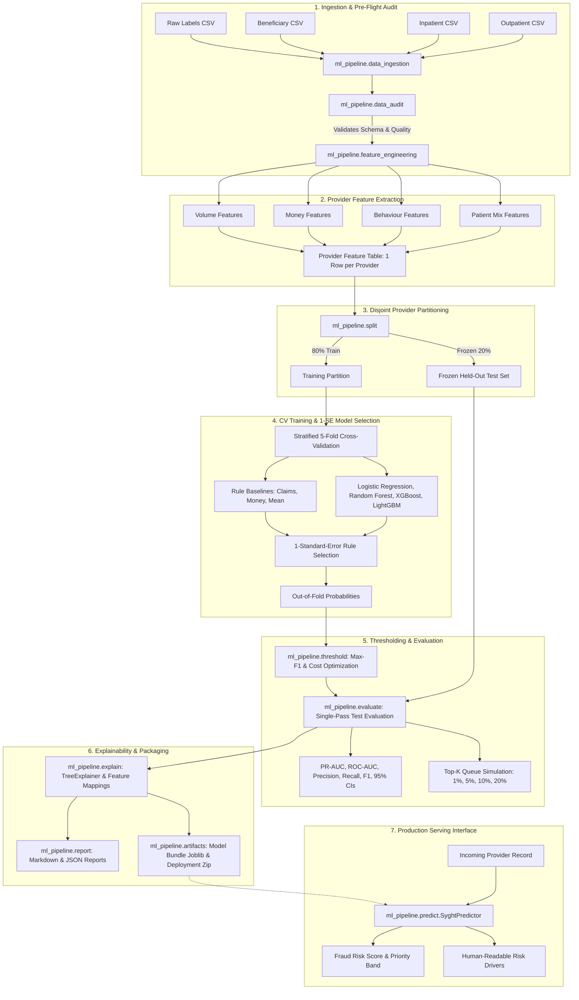

# Syght ML Pipeline Architecture & Design

**Project**: Syght — Explainable Healthcare Fraud-Risk Detection Platform  
**Document**: Architectural Design, Data Flow, Modular Components, and Inference Contract  
**Date**: October 2026  

---

## 1. System Overview

Syght is architected as an explainable, modular, and leakage-safe machine learning system. The platform transforms raw Medicare-style claims and beneficiary records into validated provider-level risk scores, ranks providers for audit prioritization, and translates model mechanics into plain-language clinical and billing explanations.



---

## 2. Pipeline Modules & Responsibilities

The pipeline is organized in the `ml_pipeline/` package:

| Module | Primary Responsibility |
|---|---|
| `config.py` | Central configuration, seed management, column mappings, feature groups, and cost parameters. |
| `data_ingestion.py` | Safe file discovery, CSV ingestion without string loss, schema validation, and defensive label derivation. |
| `data_audit.py` | Pre-flight audit checking class imbalance, conflicting labels, claim-label overlap, and structurally absent values. |
| `medicare_simulator.py` | Medicare data simulator producing exact-schema data with latent behaviors for offline testing. |
| `feature_engineering.py` | Pure transformation aggregating claims and beneficiary tables to one row per provider; enforces ethical exclusions. |
| `split.py` | Provider-level stratified partitioning and CV fold generation with programmatic leakage assertions. |
| `preprocessing.py` | Median imputation and standard scaling fitted strictly on training data folds. |
| `train.py` | Evaluates rule baselines and ML candidates across 5-fold CV; enforces baseline justification and 1-SE selection. |
| `tune.py` | Randomized hyperparameter optimization for Average Precision on training data only. |
| `threshold.py` | Decision threshold optimization via Max-F1 and expected cost modeling with recovery sensitivity sweeps. |
| `evaluate.py` | Comprehensive held-out test evaluation, 95% bootstrap confidence intervals, and Top-K queue simulations. |
| `explain.py` | SHAP explanations, directionality analysis, plain-language translations, and individual provider attributions. |
| `predict.py` | Standardized inference engine returning validated scores, priority levels, and plain-language risk factors. |
| `report.py` | Markdown and JSON benchmark report generation. |
| `artifacts.py` | Model bundle serialization, metadata tracking, and clean deployment packaging. |

---

## 3. Feature Taxonomy & Ethical Safeguards

### 3.1 Feature Groups
1. **Volume (Scale)**: Total claims filed, inpatient claims, outpatient claims, unique patients, unique physicians, claims per patient.
2. **Money (Reimbursement)**: Total reimbursement, mean reimbursement, median reimbursement, standard deviation, max reimbursement, 90th percentile, average patient deductible, inpatient vs outpatient averages.
3. **Behaviour (Clinical & Operational Patterns)**:
   - Average claim duration and hospital length of stay (LOS).
   - `ip_cv_los`: Coefficient of variation of length of stay ($\sigma_{\text{LOS}} / \mu_{\text{LOS}}$).
   - Zero-duration claims percentage.
   - Missing attending physician rate.
   - Primary diagnosis concentration (share of claims with single dominant diagnosis).
   - Attending physician concentration (share of claims signed by single dominant physician).
   - Same-day duplicate billing rate (share of claims where the same patient was billed repeatedly on the same day).
   - Geographic span: Number of unique states and counties served.
4. **Patient Mix (Comorbidity & Panel Traits)**:
   - Average patient age, patient panel mortality rate.
   - Comorbidity index: Average count of 11 CMS chronic health conditions per patient.
   - End-stage renal disease prevalence.
   - Annual reimbursement benchmarks across treated patient panels.

### 3.2 Ethical Exclusion Principle
Features capturing protected or demographic attributes of patients (`Gender`, `Race`) are **strictly excluded** from the feature engineering pipeline. Scoring a healthcare provider based on the race or gender composition of their patient population is discriminatory, mathematically confounds systemic disparities with fraud, and is legally and ethically indefensible in an insurance audit context.

---

## 4. Production Inference Contract

The inference interface is implemented in `SyghtPredictor` (`ml_pipeline/predict.py`). It is designed for seamless integration into FastAPI or asynchronous microservice architectures.

### 4.1 Input Specification
The predictor accepts either a Python dictionary or a pandas DataFrame representing provider-level metrics. Missing features are imputed using the pipeline's fitted training medians.

### 4.2 Output Structure (JSON Schema)
```json
{
  "provider_id": "PRV51001",
  "fraud_risk_score": 0.8425,
  "decision_threshold": 0.5800,
  "investigation_recommended": true,
  "priority_level": "CRITICAL",
  "model_version": "1.0.0",
  "model_name": "XGBoost",
  "key_risk_drivers": [
    {
      "feature": "pct_duplicate_bene_claims_same_day",
      "description": "Share of claims where the same patient was billed multiple times on the same date",
      "observed_value": 0.185,
      "shap_contribution": 0.2415
    },
    {
      "feature": "top_physician_concentration",
      "description": "Share of claims concentrated under a single attending physician",
      "observed_value": 0.920,
      "shap_contribution": 0.1830
    }
  ],
  "mitigating_factors": [
    {
      "feature": "mean_patient_age",
      "description": "Average age of patients served",
      "observed_value": 72.4,
      "shap_contribution": -0.0410
    }
  ],
  "disclaimer": "Syght is a clinical and financial decision-support tool. Predictions represent statistical fraud-risk estimates for prioritized human investigator review, not legal or factual proof of fraud."
}
```
